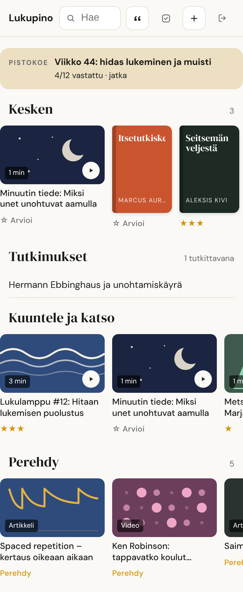
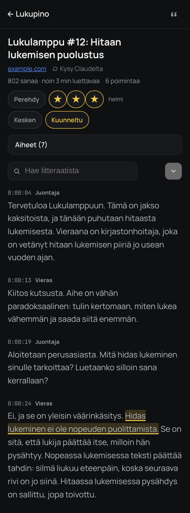
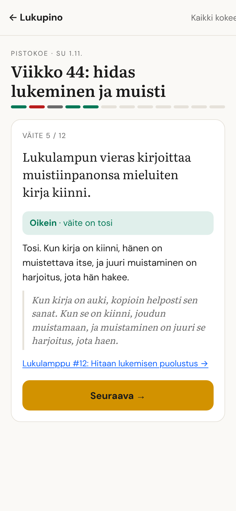
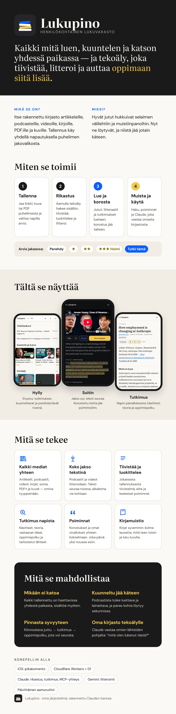
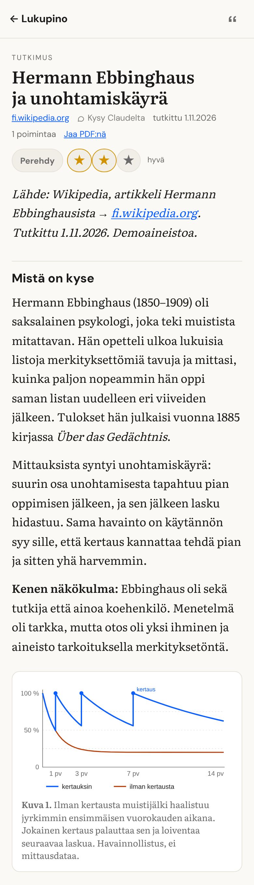
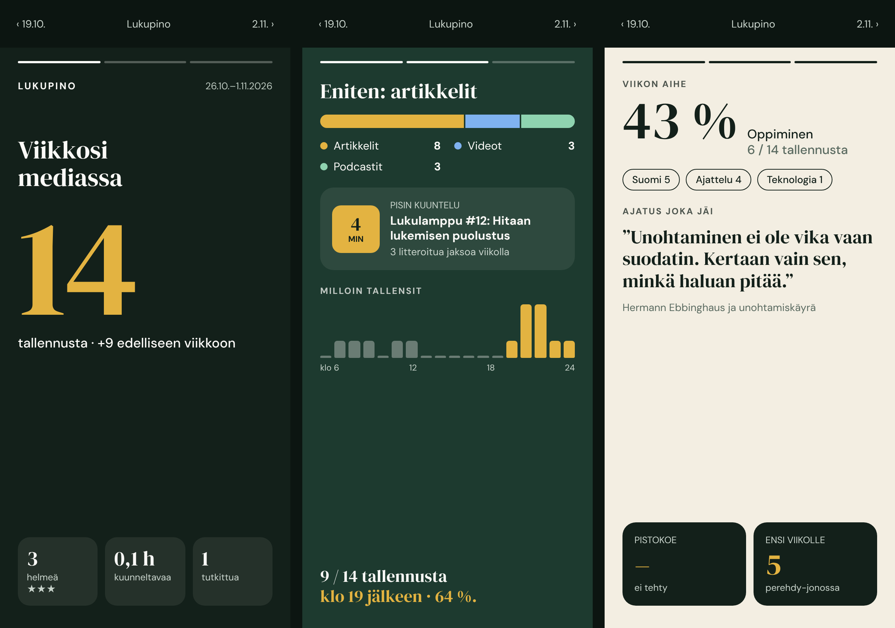
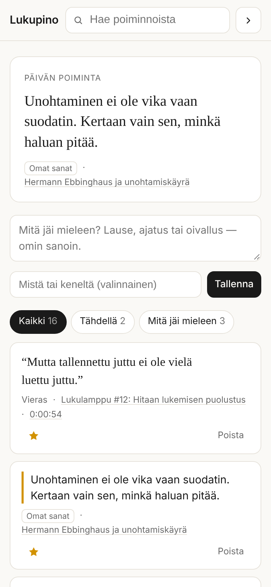
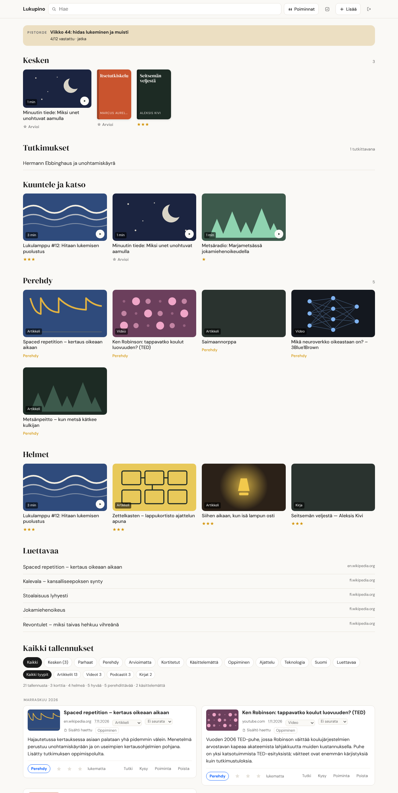
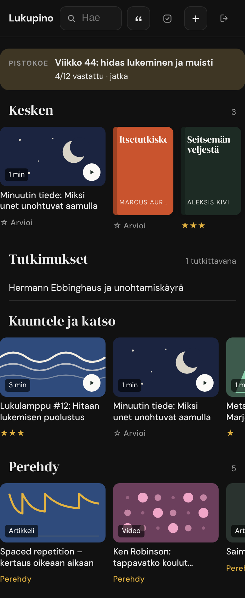
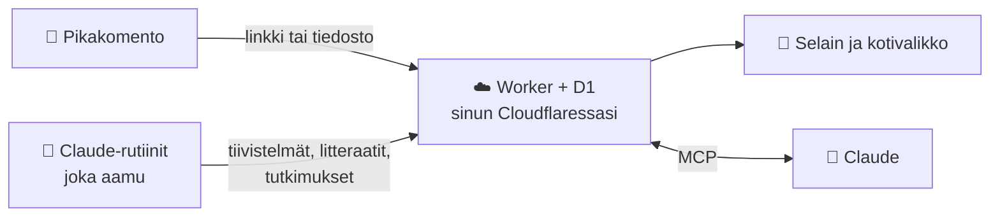

  

<h1 align="center">Lukupino</h1>

  <b>Oma lukupino puhelimeen.</b> Jaa juttu, video, podcast, kirjan sivu tai PDF, 
  ja tekoäly tekee yöllä tiivistelmät, litteraatit ja tutkimukset. 
  Sunnuntaisin pistokoe siitä, mitä viikolla luit.

  
  
  

  Pyörii omalla Cloudflare-tililläsi ilmaiseksi · data on sinun · iPhone-ensin · tehty agenttien asennettavaksi

---

## Asennus: anna tämä agentille

Avaa [Claude Code](https://claude.ai/code) (tietokoneella tai iPhonen selaimessa) ja kirjoita:

> **Asenna minulle Lukupino tästä reposta: &lt;liitä tämän sivun osoite&gt;. Noudata INSTALL.md:tä.**

Agentti kysyy muutaman asian, tekee teknisen osuuden ja neuvoo kohdat, joihin
tarvitaan sinua (tilien luonti, yksi GitHub-lomake, iPhonen pikakomento).
Aikaa menee noin tunti [oletus]. **En tiedä mitä git tai Cloudflare on?** →
[Aloita tästä](docs/ALOITA-TASTA.md).

**Kysy agentilta mitä tahansa**, missä vaiheessa tahansa: *"mikä on token?"*,
*"paljonko tämä maksaa?"*, *"miksi pikakomento sanoo ✗?"*. Se keskeyttää,
vastaa [usein kysyttyjen](docs/UKK.md) ja muiden dokumenttien perusteella ja
jatkaa sitten siitä, mihin jäitte. Ja kun se on epävarma, se kysyy sinulta.

<b>Lukupino yhdellä kuvalla</b> (infograafi)

## Mitä se tekee

| | |
|---|---|
| 📥 **Tallennus yhdellä eleellä** | iPhonen jakovalikko → *Lukupino* → arvio (★–★★★, *Perehdy* tai *Tutki tämä*). Linkit, kuvat ja PDF:t. |
| 📚 **Hylly** | Kesken olevat, kuunneltavat, tutkimukset, helmet ja luettavaa yhdellä silmäyksellä. |
| 🎧 **Litteraatti ja soitin** | Videosta tai podcastista sanatarkka teksti aikaleimoineen; teksti seuraa toistoa, korosta lause poiminnaksi. |
| 🔎 **Tutkimus** | Jaa numerolla 4, niin aamulla odottaa syventävä tutkimus kaavioineen ja oppimispolkuineen. Jaettavissa PDF:nä. |
| ✅ **Pistokoe** | Sunnuntaisin 12 oikein/väärin-väitettä viikon lukemisista; palaute kertoo, mikä jäi mieleen ja mitä kerrata. |
| ✍️ **Poiminnat ja kirjamuistio** | Lainauskokoelma, omat oivallukset ja kirjoille oma muistiopohja. |
| 📊 **Viikko mediassa** | Wrapped-tyylinen viikkokooste. |
| 💬 **Claude näkee pinosi** | claude.ai- ja Claude-sovelluksen liitin: *"mitä tallensin tekoälystä tällä viikolla?"* |

  
  
  

  
  

## Kolme tasoa

| Taso | Saat | Tarvitset | Hinta |
|---|---|---|---|
| **1. Pino** | Tallennus, selaus, haku, arviot, korostukset, poiminnat, viikkokooste | GitHub, Cloudflare, iPhone | 0 € |
| **2. + Claude** | Claude-sovellus lukee ja hakee pinoasi | + Claude (ilmainenkin käy) | 0 € |
| **3. + Automaatio** | Tiivistelmät, litteraatit, tutkimukset, pistokokeet | + Claude Pro, Gemini-avain | Clauden tilaus + Gemini käytön mukaan |

## Miten se toimii

Yksi Cloudflare Worker hoitaa tallennuksen, käyttöliittymän, kirjautumisen ja
Clauden liittimen. Worker ei kutsu tekoälyä itse: raskaan työn tekevät
Claude-rutiinit, jotka lukevat ohjeensa tästä reposta. Lisää:
[arkkitehtuuri](docs/ARCHITECTURE.md).

## Dokumentaatio

| Dokumentti | Kenelle | Mitä kertoo |
|---|---|---|
| [docs/ALOITA-TASTA.md](docs/ALOITA-TASTA.md) | ihminen, nollasta | Mikä on git, GitHub, Cloudflare, MCP; mitä tilejä tarvitset; mitä se maksaa |
| [INSTALL.md](INSTALL.md) | agentti | Asennus, päivitys ja poisto vaihe vaiheelta, tarkistuksineen |
| [docs/IPHONE.md](docs/IPHONE.md) | ihminen | Pikakomento, kotivalikko, testaus ja vianetsintä |
| [docs/MCP.md](docs/MCP.md) | ihminen ja agentti | Claude-liitin, Claude Code ja muut MCP-asiakkaat: vaatimukset, ohjeet, vianetsintä |
| [docs/UKK.md](docs/UKK.md) | ihminen ja agentti | Usein kysytyt kysymykset; agentti vastaa näistä |
| [docs/KAYTTO.md](docs/KAYTTO.md) | ihminen ja agentti | Jokainen ominaisuus käyttöohjeineen ja päätteineen |
| [routines/README.md](routines/README.md) | ihminen ja agentti | Aamu- ja sunnuntairutiinien luonti claude.ai:ssa |
| [AGENTS.md](AGENTS.md) | agentti | Jatkokehitys: kartta, komennot, invariantit, reseptit, dokumentaatiosäännöt |
| [docs/ARCHITECTURE.md](docs/ARCHITECTURE.md) | molemmat | Rakenne, tiedonkulku, oikeudet, tietomalli, ratkaisut ja niiden syyt |
| [docs/STATUS.md](docs/STATUS.md) | molemmat | Tila nyt, seuraavat askeleet, avoimet päätökset |
| [docs/INFRA.md](docs/INFRA.md) | molemmat | Palvelut, salaisuuksien ja muuttujien nimet, rajat, kustannukset |
| [docs/CHANGELOG.md](docs/CHANGELOG.md) | molemmat | Muutokset ja miksi niillä oli väliä; **Toimenpide**-merkinnät päivittäjille |
| [SECURITY.md](SECURITY.md) | molemmat | Uhkamalli, tokenien oikeudet, auditointi, haavoittuvuuksista ilmoittaminen |
| [CLAUDE.md](CLAUDE.md) | Claude Code | Claude-kohtaiset huomiot (tuo AGENTS.md:n) |

## Lisenssi

[PolyForm Noncommercial 1.0.0](LICENSE): vapaa henkilökohtaiseen käyttöön,
harrastukseen, opiskeluun ja voittoa tavoittelemattomille. Kaupallinen käyttö
vain erikseen sovittaessa. Kolmansien osapuolten osat: [NOTICE](NOTICE).

Ohjelma toimitetaan sellaisenaan, ilman takuuta. Käytät omia tilejäsi ja
avaimiasi (Cloudflare, GitHub, Anthropic, Google), ja niiden ehdot koskevat
sinua. Litteraatit ja tutkimukset ovat henkilökohtaiseen käyttöön.
