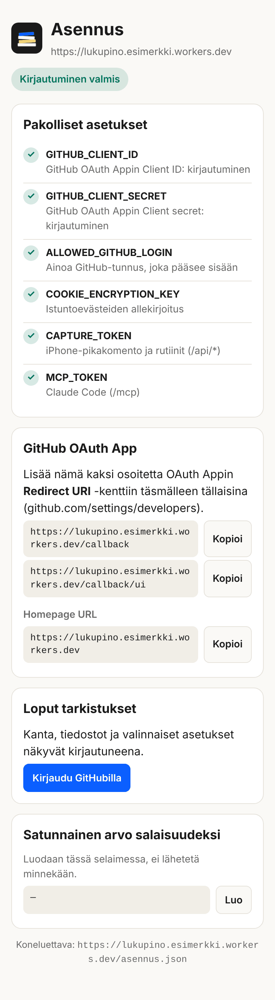

# Turvallisuus

## Haavoittuvuudesta ilmoittaminen

**Älä avaa julkista issueta.** Käytä GitHubin yksityistä ilmoitusta: repon
*Security*-välilehti → *Report a vulnerability*. Kerro mitä, miten toistaa ja
mitä sillä voi tehdä. Kaikki, millä pääsee lukemaan tai kirjoittamaan
lukupinoa ilman omistajan tunnuksia, käsitellään kriittisenä.

## Uhkamalli

Jokainen asennus on yhden ihmisen oma, hänen omalla Cloudflare-tilillään.
Suojattavaa on kaksi asiaa: **lukupinon sisältö** (mitä luet, poiminnat,
muistiinpanot) ja **tokenit**, joilla siihen pääsee.

| Uhka | Suoja | Missä |
|---|---|---|
| Joku internetissä yrittää lukea tai kirjoittaa | Kaikki datareitit vaativat istunnon (GitHub-kirjautuminen, vain `ALLOWED_GITHUB_LOGIN`) tai bearer-tokenin; vertailut vakioaikaisia | `src/ui.ts`, `src/api.ts`, `src/index.ts`, `src/session.ts` |
| Väärennetty istuntoeväste | HMAC-SHA256 avaimella `COOKIE_ENCRYPTION_KEY`; ilman avainta mikään eväste ei kelpaa | `src/session.ts` |
| CSRF OAuth-kulussa | State sidottu sekä KV:hen että selaimen evästeeseen; asiakas ja paluuosoite tarkistetaan rekisteristä ennen tilan tallennusta | `src/workers-oauth-utils.ts`, `src/github-handler.ts` |
| Tallennettu HTML/SVG yrittää ajaa skriptiä istunnossasi | `Content-Security-Policy: sandbox` ilman `allow-same-origin`ia ja `nosniff`; katselusivun iframe `sandbox` | `src/files.ts`, `src/api.ts` |
| Tutkimuksen (mallin kirjoittama) SVG tai kaavio yrittää ajaa skriptiä | SVG siivotaan ja näytetään kuvana (``), ei sivuun upotettuna; Mermaid on lukittu versioon 10.9.5 eheystarkisteella (SRI); tutkimussivuilla CSP, joka sallii skriptit vain omasta osoitteesta ja jsDelivristä ja yhteydet vain omaan osoitteeseen | `src/research.ts`, `src/tutkimus.ts`, `src/ui.ts` |
| Tallennetun sivun teksti yrittää ohjata Claudea (prompt injection) | Rutiinien token `ROUTINE_TOKEN` on rajattu: palvelin hylkää arvion, lukutilan, omin sanoin -kentän ja tuonnin (403), vaikka malli tottelisi. Skriptit saavat vain tallennuksen tunnuksen, eivät vieraita osoitteita komentoriville. Lisäksi ohjeteksti: sisältö on dataa, ei ohjeita; rutiinit eivät commitoi | `src/api.ts`, `skills/litteroi/`, `routines/` |
| Token vuotaa (esim. jaettu pikakomento) | Tokenit ovat 64 heksamerkin satunnaisarvoja; `/asennus` varoittaa lyhyistä ja näyttää arvot vain 15 minuutin sisällä kirjautumisesta; kierrätys alla | `src/asennus.ts` |
| Tallennettu osoite ei ole http(s) (`javascript:` ym.) | Hylätään tallennettaessa | `src/db.ts` |
| Asennuksen tiedot vuotavat julkiseen repoon | Ei salaisuuksia koodissa; `export/` gitignoressa; julkaisun vartija hylkää tunnisteet ja osoitteet | `.gitignore`, ylläpitäjän julkaisuskripti |
| `/asennus` paljastaa liikaa | Kirjautumatta vain pakollisten asetusten olemassaolo (kyllä/ei) ja callback-osoitteet. Arvot vain kirjautuneelle, sumennettuina | `src/asennus.ts` |

<p align="center"><br><sub>Tämän kuka tahansa näkee osoitteesta <code>/asennus</code>: ei arvoja, ei dataa.</sub></p>

## Tokenien oikeudet

| Token | Antaa | Missä se on |
|---|---|---|
| `CAPTURE_TOKEN` | **Kaiken `/api/*`:n:** tallennus, päivitys, koko kannan vienti | iPhonen pikakomento |
| `ROUTINE_TOKEN` | `/api/*` paitsi omistajan kentät (arvio, lukutila, omin sanoin), tuonti ja arvion antaminen. Vienti on sallittu, koska rutiini tarvitsee sen | rutiinien ympäristö (`LUKUPINO_CAPTURE_TOKEN`) |
| `MCP_TOKEN` | Kaikki MCP-työkalut: haku, luku, lisäys, muokkaus, poisto | Claude Coden ympäristö (`LUKUPINO_MCP_TOKEN`) |
| claude.ai-liittimen OAuth-token | Samat MCP-työkalut | Anthropicin palvelussa, sinun tililläsi |
| `COOKIE_ENCRYPTION_KEY` | Istuntojen väärentäminen, jos vuotaa | Vain Cloudflaressa |

**Kierrätys** (jos token on voinut vuotaa):

```bash
openssl rand -hex 32 | npx wrangler secret put CAPTURE_TOKEN
```

Päivitä sen jälkeen uusi arvo (kopioi `/asennus`-sivulta) pikakomentoon.
`ROUTINE_TOKEN` samoin rutiinien ympäristöön, `MCP_TOKEN` Claude Codeen, ja
`COOKIE_ENCRYPTION_KEY`:n vaihto kirjaa kaikki selaimet ulos.

## Asentajan muistilista

- Älä koskaan jaa omaa pikakomentoasi: siinä on tokenisi.
- GitHub OAuth Appissa vain kaksi tarkkaa callback-osoitetta, ei jokerimerkkejä.
- Pidä forkki yksityisenä, jos käytät viikoittaista vientiä (skillin vaihe 4): vienti sisältää koko pinosi.
- Anna rutiineille `ROUTINE_TOKEN`, älä `CAPTURE_TOKEN`ia.
- Rajattu verkko rutiinien ympäristössä (`routines/README.md`) vähentää sitä, minne vieraan sivun ohjaama malli voisi lähettää dataa.
- Ota R2 käyttöön, jos voit: silloin tiedostojen tallennus ei riipu KV:n päivittäisestä kirjoituskiintiöstä (ks. *Tunnetut rajoitukset*).
- Lue rutiinien vastaukset silloin tällöin. **HUOMIO OMISTAJALLE** tarkoittaa, että jokin ei täsmää.

## Tunnetut rajoitukset

- **KV-kirjoituskiintiö.** MCP:n OAuth vaatii julkisen asiakasrekisteröinnin (`/register`), ja jokainen rekisteröinti on yksi KV-kirjoitus. Ilmaistason 1 000 kirjoitusta päivässä voi kuluttaa tahallaan, jolloin claude.ai-kirjautuminen ja (ilman R2:ta) tiedostojen tallennus estyvät klo 00.00 UTC asti. Dataa ei vuoda eikä katoa. `workers.dev`-osoitteeseen ei saa Cloudflaren nopeusrajoitussääntöä; omalla verkkotunnuksella saa.
- **CSP vain tutkimussivuilla.** Muut sivut ajavat sivun omia inline-skriptejä eivätkä näytä mallin kirjoittamaa HTML:ää; niiden CSP on seuraavan auditoinnin aihe.
- **CSRF-suoja `/ui/*`-reiteillä** nojaa `SameSite=Lax`-evästeeseen.

## Auditointi

Ylläpitäjä ajaa ennen jokaista julkaisua Cloudflaren
[security-audit-skillin](https://github.com/cloudflare/security-audit-skill)
(MIT). Se tarkastaa lähdekoodin: useampi agentti metsästää haavoittuvuuksia
koodin luottamusrajoilta, ja jokaisen löydöksen tarkistaa eri agentti kuin sen
löytänyt. Tulos jaetaan vahvistettuihin, tarkistusta odottaviin ja hylättyihin.
Skilli ei koske tuotantoon eikä ulkoisiin palveluihin.

Asentajien ei tarvitse ajaa sitä: jokainen asennus ajaa samaa koodia, joten
yksi tarkastus versiota kohden kattaa kaikki. Oman kopion voi toki tarkastaa.

**Näin ajetaan** (agentti, jossa rinnakkaiset aliagentit, esim. Claude Code):

```bash
npx skills add https://github.com/cloudflare/security-audit-skill --skill security-audit
```

Kehote repon juuressa: *"security audit this codebase, output to
~/security-audit-skill/lukupino"*. Profiilit: `quick` (nopea ensikatsaus),
`standard` (oletus), `deep` (ennen isoa julkaisua). Ajot ovat kumulatiivisia:
toinen ajo jatkaa ensimmäisen kattavuudesta. Raportti kirjoitetaan repon
ulkopuolelle.

**Löydösten käsittely:**

1. Vahvistetut korjataan ennen julkaisua; korjaus kirjataan CHANGELOGiin (ilman hyökkäysohjetta).
2. Tarkistusta odottavat kirjataan yksityisesti ja ratkaistaan seuraavassa ajossa.
3. Raakaraporttia ei julkaista ennen kuin vahvistetut on korjattu. Yhteenveto lisätään alla olevaan taulukkoon.

| Päivä | Commit | Profiili | Vahvistettuja | Korjattu | Huomio |
|---|---|---|---|---|---|
| 7.11.2026 | `40bd221` (julkinen) | `quick`, vain lähdekoodi | 0 | 6/6 epäilyä lievennetty | Kuusi epäilyä, kaikki *tarkistusta odottavia*: ratkaiseva asia (selaimen tai mallin käytös) vaatii eristetyn ajoympäristön, jota ei ollut. Jokaisen juurisyy näkyi koodissa, joten kaikki korjattiin tai lievennettiin (alla). Kattavuus osittainen: 12 aluetta katettu, 3 lykätty |

### 7.11.2026: epäilyt ja korjaukset

| Epäily | Korjaus |
|---|---|
| Tutkimusten SVG: kieltolistasiivous ja upotus kirjautuneeseen sivuun | SVG näytetään kuvana (``); CSP tutkimussivuille |
| Mermaid CDN:stä ilman eheystarkistetta (10.9.1) | 10.9.5 SRI-tarkisteella, tiedosto verrattu npm-paketin eheyteen; CSP |
| Skillien komentopohjat: vieraat osoitteet komentoriville | Skriptit ottavat vain tunnuksen ja hakevat osoitteen itse (`GET /api/bookmark/:id`); puhujat tiedostosta |
| Rutiinien täysivaltainen token | `ROUTINE_TOKEN`, jolta palvelin hylkää omistajan kentät ja tuonnin |
| Litteraatin aikaleimalinkki ilman escapointia | Videon ja jakson tunnus hyväksytään vain tunnetussa muodossa; linkki escapetaan |
| OAuth-rekisteröinti ja suostumus kuluttavat KV-kiintiötä | Suostumus tarkistaa asiakkaan ennen kirjoitusta; rekisteröinti on MCP:n vaatimus (ks. *Tunnetut rajoitukset*) |

Lisäksi: `/asennus` näyttää tokenit vain tuoreelle istunnolle, `/file` lähettää aina `nosniff`, tallennettavat osoitteet rajattu http(s):ään ja istuntoeväste hylätään ilman avainta. Seuraava ajo: profiili `standard`, ja epäilyt tarkistetaan eristetyssä selain- ja ajoympäristössä.
