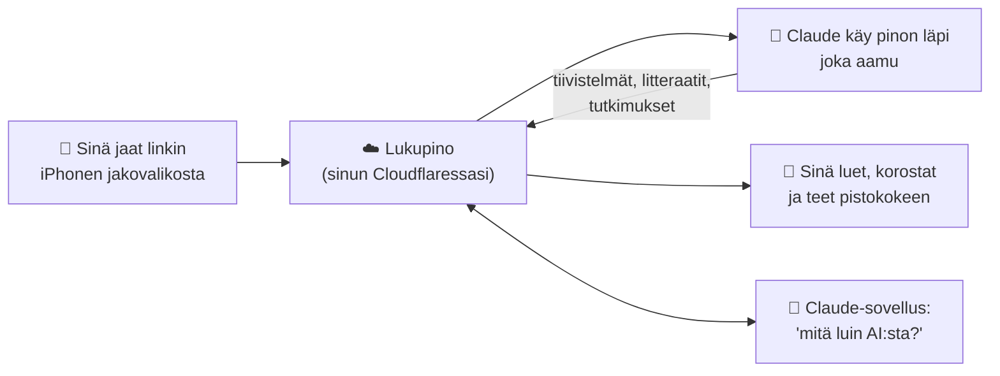
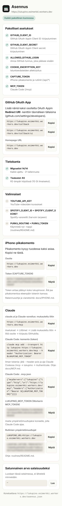

# Aloita tästä — kaikki mitä tarvitset tietää, nollasta

Tämä sivu on ihmiselle, joka ei ole koskaan kuullut sanoja *git*, *Cloudflare*
tai *MCP*. Lue tämä kerran, niin tiedät mitä asennuksessa tapahtuu, mitä tilejä
tarvitset ja mitä se maksaa. Itse asennuksen tekee puolestasi tekoälyagentti
([INSTALL.md](../INSTALL.md)); sinä teet vain ne kohdat, joihin tarvitaan
sinun sormiasi.

## Mikä Lukupino on

Lukupino on **oma lukupinosi**: paikka, johon heität puhelimella kaiken
kiinnostavan (jutut, videot, podcastit, kirjan sivut, PDF:t), ja josta tekoäly
tekee sinulle yön aikana tiivistelmät, litteraatit ja tutkimukset. Sunnuntaisin
saat pistokokeen siitä, mitä viikolla luit.

Se pyörii **sinun omalla Cloudflare-tililläsi**, joten data on sinun, eikä
kukaan muu (ei edes Lukupinon tekijä) näe sitä.

## Miten kaikki liittyy yhteen

## Sanasto

| Sana | Mitä se on | Miksi Lukupino tarvitsee sen |
|---|---|---|
| **Git** | Ohjelma, joka pitää kirjaa tiedostojen muutoksista. Jokainen tallennettu muutos on *commit*. | Koodi ja ohjeet ovat gitissä, joten jokainen muutos on jäljitettävissä ja peruttavissa. |
| **GitHub** | Verkkopalvelu, jossa git-projekteja (*repoja*) säilytetään. Ilmainen. | Koodi on täällä. Kirjaudut Lukupinoon GitHub-tunnuksellasi. |
| **Repo** | Yksi projekti GitHubissa: koodi, ohjeet ja historia. | Lukupino on yksi repo. |
| **Forkki** | Oma kopiosi jonkun toisen reposta, omalla tililläsi. | Sinun Lukupinosi rakennetaan sinun forkistasi; päivitykset saat painamalla *Sync fork*. |
| **Cloudflare** | Yhtiö, jonka palvelimet ovat ympäri maailmaa. Pienille projekteille ilmainen. | Lukupino pyörii siellä. |
| **Worker** | Cloudflaren palvelu, joka ajaa pienen ohjelman aina kun joku avaa osoitteen. | Lukupino on yksi Worker. Osoite on muotoa `https://lukupino.<tili>.workers.dev`. |
| **D1** | Cloudflaren tietokanta. | Tallennuksesi, poiminnat, litteraatit ja tutkimukset. |
| **KV** ja **R2** | Cloudflaren tallennustilat. KV pienille tiedoille, R2 isoille tiedostoille. | Kirjautumistiedot ja kuvat ja PDF:t. R2 on valinnainen. |
| **OAuth** | Tapa kirjautua palveluun toisen palvelun tunnuksilla ("Kirjaudu GitHubilla"). | Kirjautuminen Lukupinoon ilman omaa salasanaa. Vain sinun GitHub-tunnuksesi pääsee sisään. |
| **Token** | Pitkä satunnainen merkkijono, joka toimii avaimena. | iPhonen pikakomento ja Claude todistavat sillä olevansa sinun. **Pidä se salassa.** |
| **Salaisuus** *(secret)* | Token tai avain, joka tallennetaan Cloudflareen eikä koodiin. | Kukaan ei näe niitä koodista, ei edes julkisesta reposta. |
| **Claude** | Anthropicin tekoäly. | Lukee pinoasi, tiivistää, tutkii ja tekee pistokokeet. |
| **Claude Code** | Claude, joka osaa ajaa komentoja ja muokata koodia. Toimii tietokoneella tai selaimessa (claude.ai/code). | Asentaa Lukupinon puolestasi. |
| **Rutiini** *(routine)* | Ajastettu Claude Code -tehtävä, esim. "joka aamu klo 6". | Aamun rikastus ja sunnuntain pistokoe. |
| **MCP** ja **liitin** | Tapa, jolla Claude pääsee käsiksi toiseen palveluun. Liitin lisätään claude.ai:n asetuksista. | Claude-sovellus voi hakea, lukea ja lisätä pinoosi. |
| **Pikakomennot** *(Shortcuts)* | iPhonen oma sovellus pienille automaatioille. | *Lukupino*-pikakomento jakovalikossa lähettää linkin pinoon. |
| **Gemini** | Googlen tekoäly, joka osaa kuunnella ääntä ja katsoa videota. | Tekee podcasteista ja videoista litteraatit. |

## Mitä tarvitset

### Tilit

| Tili | Mistä | Hinta | Mihin |
|---|---|---|---|
| **GitHub** | [github.com/signup](https://github.com/signup) | ilmainen | Koodi ja kirjautuminen |
| **Cloudflare** | [dash.cloudflare.com/sign-up](https://dash.cloudflare.com/sign-up) | ilmainen | Lukupino pyörii täällä. R2 (valinnainen) vaatii maksutavan, mutta ilmaistaso riittää |
| **Claude** | [claude.ai](https://claude.ai) | ilmainen tai Pro | Ilmaisella: Claude voi lukea pinoasi (yksi mukautettu liitin). **Pro tai ylempi:** asennus Claude Codella ja aamurutiinit |
| **Google AI Studio** *(valinnainen)* | [aistudio.google.com](https://aistudio.google.com) | käytön mukaan | Litteraatit. EU:ssa avain projektiin, johon on liitetty laskutus |
| **Apple ID** | iPhonessa jo | — | Pikakomennot |

### Laitteet

- **iPhone** (Pikakomennot-sovellus on valmiina).
- Asennukseen **joko** tietokone, jossa on Claude Code, **tai** pelkkä iPhone ja
  Claude Code selaimessa (claude.ai/code). Tietokoneella on helpompaa.

### Kolme tasoa: valitse kuinka pitkälle menet

| Taso | Saat | Tarvitset | Hinta |
|---|---|---|---|
| **1. Pino** | Tallennus jakovalikosta, selaus, haku, arviot, korostukset, poiminnat, viikkokooste | GitHub, Cloudflare, iPhone | 0 € |
| **2. + Claude** | Claude-sovellus hakee ja lukee pinoasi: *"mitä tallensin tekoälystä tällä viikolla?"* | + Claude (ilmainenkin käy) | 0 € |
| **3. + Automaatio** | Aamuisin tiivistelmät, litteraatit, tutkimukset; sunnuntaisin pistokoe | + Claude Pro, Gemini-avain | Clauden tilaus + Gemini noin kymmeniä senttejä tunnilta ääntä [oletus, tarkista Googlen hinnasto] |

## Miten asennus etenee

**Aikaa menee noin tunti** [oletus], josta suurin osa on tilien luomista ja
kopiointia. Agentti tekee teknisen osuuden ja kertoo jokaisessa kohdassa, mitä
sinun pitää tehdä.

| Agentti tekee | Sinä teet |
|---|---|
| Kopioi koodin, asentaa työkalut, tarkistaa että kaikki kääntyy | Luot tilit (GitHub, Cloudflare) |
| Luo Cloudflareen tietokannan ja tallennustilat ja julkaisee Lukupinon | Hyväksyt Cloudflare-kirjautumisen selaimessa |
| Luo tokenit ja tallentaa ne salaisuuksiksi | Teet GitHubiin "OAuth App" -lomakkeen agentin antamilla arvoilla |
| Tarkistaa asennuksen sivulta `/asennus.json` | Kirjaudut puhelimella ja lisäät Lukupinon kotivalikkoon |
| Luo aloituslistat aiheistasi | Asennat pikakomennon ja testaat kolmella jaolla |
| Neuvoo liittimen ja rutiinien asetukset | Lisäät liittimen ja rutiinit claude.ai:ssa |

Aloita näin: avaa Claude Code ja kirjoita

> *Asenna minulle Lukupino tästä reposta: &lt;liitä tämän repon osoite&gt;. Noudata INSTALL.md:tä.*

**Voit kysyä agentilta mitä tahansa** missä vaiheessa tahansa ("mikä tämä
on?", "miksi tätä tarvitaan?", "onko tämä turvallista?"). Se vastaa
[usein kysyttyjen kysymysten](UKK.md) ja näiden ohjeiden perusteella ja jatkaa
sitten. Ja kun agentti ei tiedä jotain sinusta (tunnuksesi, valintasi), se
kysyy eikä arvaa.

Kun jokin menee pieleen, sivu **`/asennus`** omassa Lukupinossasi kertoo
vihreällä ja punaisella, mikä on kunnossa ja mikä puuttuu.

## Kuka näkee mitä

| Kuka | Mitä näkee | Miksi |
|---|---|---|
| **Sinä** | Kaiken | Ainoa sallittu GitHub-tunnus |
| **Cloudflare** | Tallennukset teknisesti (palvelin on heidän) | Isännöinti |
| **Anthropic (Claude)** | Ne tallennukset, joita Claude käsittelee rutiineissa tai keskustelussa | Tiivistelmät, tutkimukset, pistokokeet |
| **Google (Gemini)** | Litteroitavan videon tai jakson äänen | Litterointi |
| **Lukupinon tekijä tai muut käyttäjät** | Ei mitään | Jokainen ajaa omaa kopiotaan omalla tilillään |

Lukupinon koodi voi olla julkinen, koska siinä ei ole yhtään salaisuutta eikä
kenenkään dataa. Salaisuudet ovat Cloudflaressa, data D1-tietokannassasi.

## Seuraavaksi

- Asenna: [INSTALL.md](../INSTALL.md) (agentille) tai aloita yllä olevalla lauseella.
- Mitä kaikkea Lukupinolla voi tehdä: [KAYTTO.md](KAYTTO.md).
- iPhonen pikakomento: [IPHONE.md](IPHONE.md).
- Claude lukemaan pinoasi: [MCP.md](MCP.md).
- Kysymyksiä: [UKK.md](UKK.md).
- Miten se on rakennettu: [ARCHITECTURE.md](ARCHITECTURE.md).
