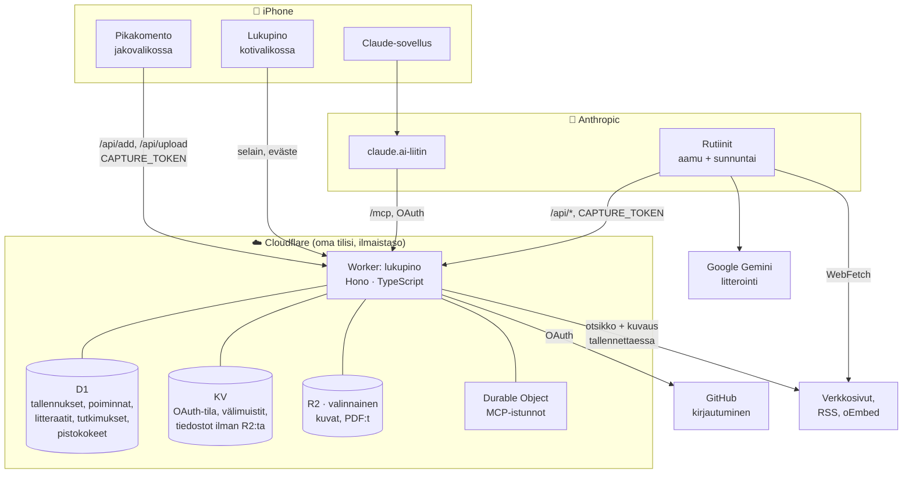
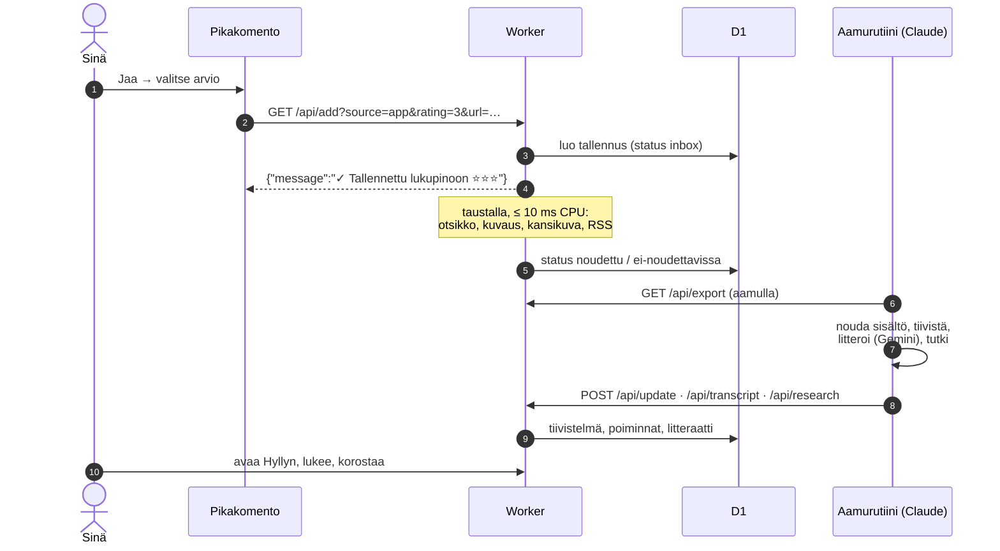
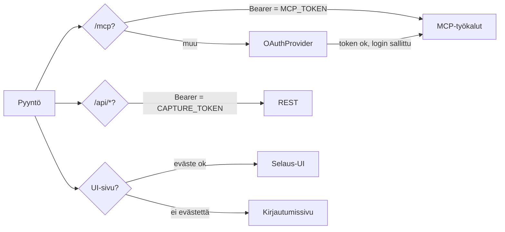
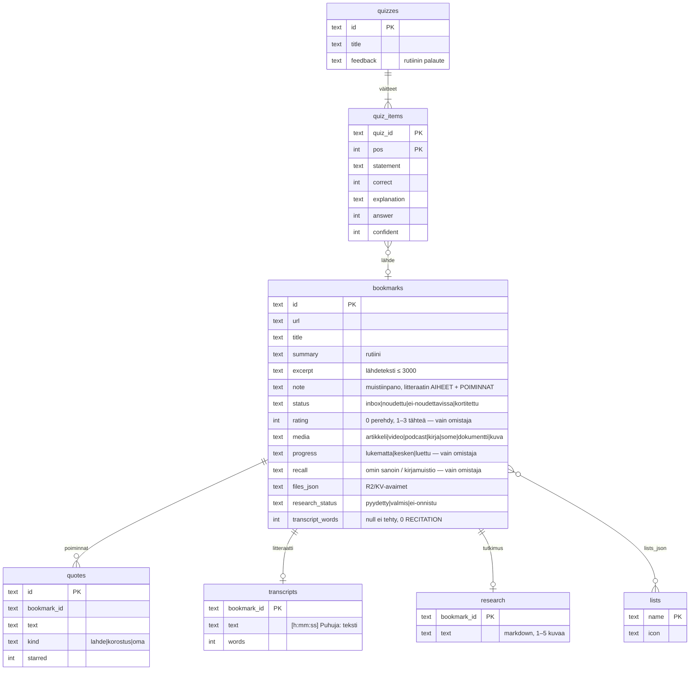

# Arkkitehtuuri

Lukupino on yksi Cloudflare Worker, joka tekee kaiken: tallentaa, näyttää,
kirjautuu ja palvelee Claudea. Raskas työ (tiivistelmät, litteraatit,
tutkimukset, pistokokeet) tehdään Workerin ulkopuolella Claude-rutiineissa,
jotka puhuvat Workerille sen omalla REST-rajapinnalla.

Kaaviot ovat Mermaidia, joten GitHub piirtää ne ja agentti lukee ne tekstinä.

## Kokonaiskuva

## Tallennuksen elinkaari

Tila (`status`): `inbox` → `noudettu` tai `ei-noudettavissa` → `kortitettu`
(muistiinpano tai litteraatti valmis). **Tekemätön työ tunnistetaan siitä, että
tiivistelmä puuttuu, ei statuksesta** (ks. `skills/lukupino-rikasta`, vaihe 1).

## Kirjautuminen ja oikeudet

| Kuka | Mihin | Miten |
|---|---|---|
| Sinä selaimessa | `/`, `/ui/*`, `/file/*`, kaikki sivut | GitHub OAuth → HMAC-allekirjoitettu eväste 30 pv (`session.ts`). Vain `ALLOWED_GITHUB_LOGIN` |
| Pikakomento, rutiinit | `/api/*` | `Authorization: Bearer <CAPTURE_TOKEN>` |
| claude.ai ja Claude-sovellus | `/mcp` | OAuth 2.1 (dynaaminen rekisteröinti + PKCE), ylävirtana GitHub, vain sallittu tunnus |
| Claude Code | `/mcp` | `Authorization: Bearer <MCP_TOKEN>` |
| Kuka tahansa | `/healthz`, kuvakkeet, `/asennus` (suppea) | Ei mitään. `/asennus` näyttää kirjautumatta vain pakollisten asetusten olemassaolon ja callback-osoitteet |

**Tokenien voima on sama:** kumpikin bearer-token antaa lukea ja kirjoittaa koko
lukupinoa (myös `/api/export`). Siksi pikakomentoa ei jaeta eteenpäin token
mukana, ja tokenit ovat 64 heksamerkin satunnaisarvoja (`openssl rand -hex 32`).

**Käyttäjien sisältö on epäluotettavaa.** Tallennettu HTML ja SVG tarjoillaan
otsakkeella `Content-Security-Policy: sandbox` ilman `allow-same-origin`ia, ja
katselusivun iframe on `sandbox`-määreellä: skriptit toimivat, mutta eivät pääse
evästeeseen eivätkä `/ui/*`-reitteihin. Tutkimusten SVG siivotaan
(`sanitizeSvg`), markdown escapetaan (`renderMarkdown`).

## Tietomalli

Täystekstihaku on FTS5-indeksi `bookmarks_fts` (otsikko, kuvaus, ote,
tiivistelmä, muistiinpano). Litteraatti on omassa taulussaan, koska kahden tunnin
jakso on noin 140 000 merkkiä: vienti ja listaus pysyvät kevyinä. Skeema syntyy
vain migraatioista (`migrations/`); odotettu lista on `src/asennus.ts`:ssä.

## Reitit

| Reitti | Mitä | Auth |
|---|---|---|
| `GET /` | Hylly ja kaikki tallennukset | eväste |
| `/lue/<id>` · `/litteraatti/<id>` · `/kirja/<id>` · `/tutkimus/<id>` · `/pistokoe/<id>` · `/poiminnat` · `/viikko` | Lukunäkymä, soitin, kirjamuistio, tutkimus, koe, poiminnat, viikkokooste | eväste |
| `GET/POST /api/add` · `POST /api/upload` | Tallennus pikakomennosta (linkki / tiedostot) | `CAPTURE_TOKEN` |
| `POST /api/update` · `/api/enrich` · `/api/import` · `GET /api/export` · `/api/lists` · `/api/stats` | Rikastus, migraatio, varmuuskopio | `CAPTURE_TOKEN` |
| `/api/transcript` · `/api/research` · `/api/quiz` · `/api/quotes` | Rutiinien kirjoitukset | `CAPTURE_TOKEN` |
| `/mcp` | MCP-työkalut (24) | OAuth tai `MCP_TOKEN` |
| `/authorize` · `/token` · `/register` · `/callback` · `/login` · `/callback/ui` | OAuth | — |
| `/asennus` · `/asennus.json` | Asennuksen itsetarkistus | julkinen suppea / eväste tai `CAPTURE_TOKEN` laaja |
| `/file/<avain>` | Tallennettu tiedosto (HTML ja SVG eristettynä) | eväste tai bearer |
| `/healthz` | `ok` | — |

Täydet päätteet kenttineen: [KAYTTO.md](KAYTTO.md) ja koodi (`src/api.ts`).

## Rajat

Ilmaistaso: 100 000 pyyntöä/pv · **10 ms CPU/pyyntö** · D1 5 Gt ja 5 M rivilukua/pv
· KV 1 000 kirjoitusta/pv ja 1 Gt · R2 10 Gt. Ylitys kaataa pyynnöt klo 00.00 UTC
asti [oletus, Cloudflaren hinnasto]. Yhden ihmisen käyttö (kymmenkunta tallennusta
päivässä) on näistä kaukana.

## Suunnitteluratkaisut ja miksi

| Ratkaisu | Miksi |
|---|---|
| **Yksi käyttäjä per asennus** | Ei käyttäjätauluja eikä tietovuotoja käyttäjien välillä. Jokainen ajaa omaa kopiotaan omalla tilillään, data on hänen. |
| **Worker ei kutsu kielimallia** | 10 ms CPU-raja ja nolla kustannusta. Tekoälytyö tehdään rutiineissa, jotka voi vaihtaa, keskeyttää tai ajaa käsin. |
| **Rutiinit REST:llä, ei MCP:llä** | Ajastettu istunto ei saa MCP-yhteyksiä (todettu 16.9.2026). REST toimii kaikkialla curlilla. |
| **Logiikka repossa, kehote ohut** | `routines/*.md` ja `skills/` ovat versionhallinnassa ja muuttuvat koodin mukana; claude.ai:n kehote on viiden rivin käynnistin. |
| **Ei tageja, vähän listoja** | Edellisessä työkalussa 300 tagia, joista 241 kertakäyttöisiä. Listat ovat aiheita, joita rutiini ei saa lisätä. |
| **`url` viimeisenä parametrina** | Pikakomento liittää osoitteen sellaisenaan; `&`-merkkiset osoitteet eivät katkea eikä koodausta tarvita. |
| **Palvelin kirjoittaa ilmoitustekstin** | iOS Pikakomennot ei tulkitse HTTP-virheitä virheiksi. `message`-kenttä ei voi valehdella onnistumista. |
| **Arvio 0 = Perehdy** | "Palaa tähän" on päätös, ei laatu; se ei saa sekoittua arvioimattomiin. |
| **Litteraatti tehdään kerran** | Ensin koko litteraatti, sitten tiivistelmä tekstistä: video tai ääni luetaan vain kerran, ja hinta putoaa murto-osaan. |
| **Gemini RECITATION ei kierretä** | Tekijänoikeussuodattimen kiertäminen ei kuulu tähän työkaluun. Tiivistelmä ja aiheet riittävät. |
| **`/asennus` ja `/asennus.json`** | Asennuksen virheet ovat kirjoitusvirheitä. Sivu näyttää asennuksen omat tarkat osoitteet ja kertoo agentille koneluettavasti, mikä puuttuu. |
