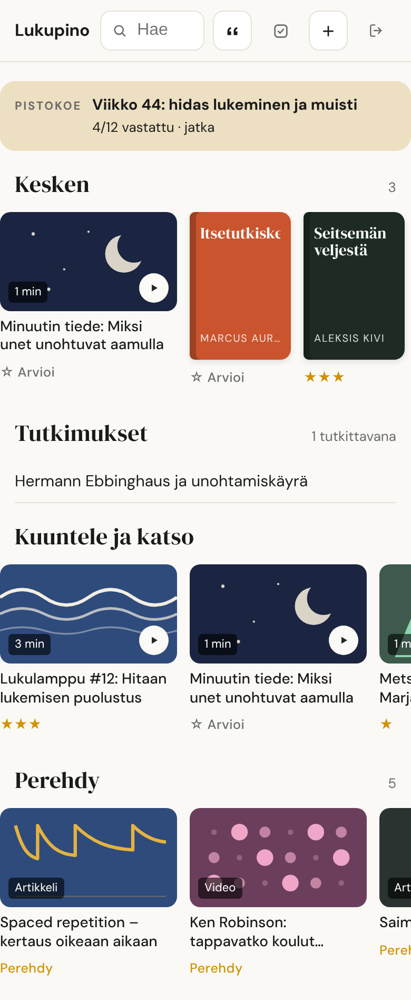

# iPhone: pikakomento ja kotivalikko

Lukupinoa käytetään puhelimella kahdella tavalla:

1. **Tallennus jakovalikosta:** *Jaa* → *Lukupino* → valitse arvio → valmis.
   Toimii Safarista, YouTubesta, Spotifysta, Kuvista, Tiedostoista ja
   useimmista sovelluksista.
2. **Lukeminen:** Lukupino kotivalikossa kuin sovellus (verkkosivu, ei App
   Storea).

**Tarvitset:** iPhonen, jossa on *Pikakomennot*-sovellus (valmiina
iOS:ssä), asennetun Lukupinon osoitteen ja `CAPTURE_TOKEN`in. Molemmat
näkyvät kopioitavina sivulla **`https://<osoitteesi>/asennus`**, kun olet
kirjautunut.

---

## 1. Kotivalikko (2 min)

1. Avaa Safarissa `https://<osoitteesi>` ja kirjaudu GitHubilla.
2. *Jaa* (neliö ja nuoli) → **Lisää Koti-valikkoon** → *Lisää*.
3. Avaa Lukupino kotivalikosta. Jos se näyttää kirjautumissivun, kirjaudu
   kerran uudelleen: kotivalikkoon lisätyllä sivulla on omat evästeensä
   [oletus, iOS:n käytös].

Kirjautuminen kestää 30 päivää.

## 2. Pikakomento

### Nopein tapa: tuo valmis pikakomento

Jos ylläpitäjä on julkaissut pikakomennon iCloud-linkkinä, avaa linkki
iPhonella → *Lisää pikakomento*. Tuonnissa kysytään kaksi asiaa:

| Kysymys | Mistä | Esimerkki |
|---|---|---|
| Lukupinon osoite | `/asennus` → *Osoite* | `https://lukupino.<tili>.workers.dev` (ei kauttaviivaa loppuun) |
| Token | `/asennus` → *Token (CAPTURE_TOKEN)* → *Näytä* → *Kopioi* (näkyy 15 min kirjautumisen jälkeen) | 64 merkkiä |

Siirry sitten kohtaan [3. Testaa](#3-testaa-kolmella-jaolla).

> **Älä koskaan jaa omaa pikakomentoasi eteenpäin.** Siinä on tokenisi, ja
> token antaa lukea ja kirjoittaa koko lukupinoasi.

### Tee itse (10 min)

Yksi pikakomento hoitaa linkit, kuvat ja PDF:t sekä kysyy arvion.

**Asetukset** (ⓘ alareunassa): *Näytä jakotaulukossa* päälle, syötetyypit
**URL:t, Safarin verkkosivut, Teksti, Kuvat ja Tiedostot**.

Toiminnot järjestyksessä:

1. **Teksti**: oma osoitteesi, esim. `https://lukupino.<tili>.workers.dev`.
   Napauta toimintoa pitkään → *Nimeä uudelleen* → `osoite`.
2. **Teksti**: tokenisi. Nimeä `token`.
3. **Hae URLit syötteestä** *(Get URLs from Input)*, syöte *Pikakomennon syöte*.
4. **Valitse valikosta** *(Choose from Menu)*, kehote `Lukupino`. Kuusi kohtaa,
   ja jokaisen alle yksi **Teksti**-toiminto, jossa on vain numero:

   | Valikon kohta | Teksti |
   |---|---|
   | ★★★ Helmi | `3` |
   | ★★ Hyvä | `2` |
   | ★ Kelpaa | `1` |
   | Perehdy | `0` |
   | Tutki tämä | `4` |
   | Ei arviota | *(tyhjä)* |

5. **Jos** *URLit* **ei ole mitään arvoa** (kuva, PDF, liite):
   **Hae sisältö URLista** *(Get Contents of URL)*
   - URL: muuttuja `osoite` + `/api/upload`
   - Menetelmä **POST**
   - Otsake `Authorization` = `Bearer ` + muuttuja `token` (välilyönti
     Bearerin jälkeen)
   - **Runko: Lomake** *(Form)*: kenttä `file`, tyyppi **Tiedosto**, arvo
     *Pikakomennon syöte*; toinen kenttä `rating`, tyyppi **Teksti**, arvo
     *Valikon tulos*
6. **Muuten** (linkki): **Hae sisältö URLista**
   - URL: muuttuja `osoite` + `/api/add?source=app&rating=` + *Valikon tulos*
     + `&url=` + *URLit* (**URLit aivan loppuun**)
   - Menetelmä **GET**, sama otsake, **ei runkoa**
7. **Lopeta jos**.
8. **Hae sanakirjan arvo** *(Get Dictionary Value)*: avain `message`
   kohteesta *Jos-tulos*.
9. **Näytä ilmoitus**: *Sanakirjan arvo*.

**Jaettava versio** (ylläpitäjälle): ennen jakamista vaihda toimintojen 1 ja
2 sisällöksi paikkamerkki, avaa pikakomennon asetukset → **Tuontikysymykset**
→ lisää kysymys kumpaankin Teksti-toimintoon (*Lukupinon osoite*, *Token*), ja
jaa iCloud-linkkinä. Tarkista jaetusta linkistä, ettei siinä ole omaa
tokeniasi.

**Sudenkuopat:**

- *Valikon tulos* on valikon jälkeen taikamuuttujana. Jos sitä ei näy,
  napauta kenttää → *Valitse muuttuja* → valikon toiminto.
- Lomakkeen `file`-kentän tyypiksi on vaihdettava **Tiedosto** (oletus on
  Teksti). Väärällä tyypillä palvelin vastaa *"Tiedosto puuttui"*.
- Kaksi peräkkäistä *Hae sisältö URLista* -toimintoa ketjuttuu: Shortcuts
  liittää uuden edellisen tulokseen. **Tyhjennä osoitekenttä heti, kun lisäät
  toiminnon.**
- `url` on oltava **viimeinen** kyselyparametri: palvelin lukee kaiken sen
  jälkeen tulevan osoitteeksi, jotta `&`-merkkiset osoitteet
  (YouTube-soittolistat, seurantaparametrit) eivät katkea. Siksi koodausta ei
  tarvita.
- Pelkkä teksti ilman linkkiä (esim. kirjan nimi) menee tiedostohaaraan,
  eikä sitä ole testattu. Kirjan voi lisätä nimellä selaus-UI:n
  *Lisää*-kentästä tai Claudelta (`add-book`).

## 3. Testaa kolmella jaolla

| Mistä | Valitse | Ilmoituksen pitää sanoa |
|---|---|---|
| Safari: mikä tahansa juttu | *Tutki tämä* | `✓ Tallennettu lukupinoon · tutkitaan` |
| Kuvat: valokuva | *★★ Hyvä* | `✓ Tallennettu lukupinoon ⭐⭐` |
| Tiedostot: PDF | *Ei arviota* | `✓ Tallennettu lukupinoon` |

Kaikkien kolmen pitää näkyä Lukupinon etusivulla ylimpänä.

## Miksi ilmoitus luetaan palvelimelta

Shortcuts ei tulkitse HTTP-virhekoodeja virheiksi: kiinteä teksti
"✓ Tallennettu" näyttäisi onnistumista myös silloin, kun palvelin vastasi
401:llä. Siksi jokainen vastaus (myös virhevastaus) sisältää
`message`-kentän, ja ilmoitus näyttää sen sellaisenaan:

| Tilanne | Ilmoituksessa lukee |
|---|---|
| Uusi tallennus | `✓ Tallennettu lukupinoon` |
| Uusi tallennus arviolla | `✓ Tallennettu lukupinoon ⭐⭐⭐` |
| Sama linkki uudelleen | `↻ Oli jo tallessa ⭐⭐` |
| Väärä tai puuttuva token | `✗ Tunnistautuminen epäonnistui — tarkista Authorization-otsikko` |
| URL-muuttuja puuttuu osoitteen lopusta | `✗ Osoite puuttui — URL-muuttuja ei ole ?url=-kohdan perässä` |
| Kuva jaettiin linkkihaaraan | `Tästä ei löytynyt linkkiä. Kuvat ja PDF:t: …` |

Ilmoitus ei voi valehdella: se on palvelimen oma kertomus siitä, mitä
tapahtui. Ilman *Hae sanakirjan arvo* -vaihetta ilmoitukseen tulisi koko
JSON-vastaus, joka toimii mutta on ruma.

## Vianetsintä

| Oire | Syy ja korjaus |
|---|---|
| Mikään ei tallennu, ei virhettä | Osoitteessa kirjoitusvirhe. Kopioi osoite sivulta `/asennus`, älä kirjoita käsin. |
| `{"error":"give ?url= …"}` | URLit-muuttuja puuttuu osoitteen lopusta. |
| `Muotoiltu teksti → URL` -virhe | Kaksi *Hae sisältö URLista* -toimintoa ketjuuntui. Tyhjennä osoitekenttä. |
| Ilmoitus näyttää ✓, vaikka mitään ei tallennu | Ilmoituksessa on oma teksti eikä palvelimen `message`. |
| `Verkkoyhteys katkesi` | Pyyntö ei päässyt perille **tai** vastaus ei palannut. Katso ensin selaus-UI:sta, onko tallennus silti tallessa. Yleisin syy on ylimääräinen *Hae sisältö URLista* tai POST tyhjällä rungolla linkkihaarassa (linkki lähetetään GETillä ilman runkoa). |
| `Tiedosto puuttui` | Lomakkeen `file`-kenttä on tyyppiä Teksti. Vaihda **Tiedosto**. |
| PDF:n kohdalla oikopolku avaa tulostuksen | Syötetyypeistä puuttuu *Tiedostot*. |

## Vaihtoehto: leikepöydältä

Kun osoite on olemassa mutta jakovalikko ei anna sitä, leikepöytäreitti
ohittaa tyyppineuvottelun kokonaan. Pikakomento **Lukupino leikepöydältä**:

1. **Hae sisältö URLista**: `osoite` + `/api/add?source=app&url=` +
   **Leikepöytä** aivan loppuun. Menetelmä **GET**, otsake
   `Authorization` = `Bearer <token>`, ei runkoa.
2. **Hae sanakirjan arvo** avaimella `message` → **Näytä ilmoitus**.

Käyttö: paina Safarin osoiteriviä → *Kopioi* → aja pikakomento. Osoitteen ei
tarvitse olla siisti: palvelin lisää puuttuvan `https://`:n, riisuu
lainausmerkit ja koodaa välilyönnit.

## Varareitti: erilliset pikakomennot arvioittain

Jos valikko ei suostu toimimaan, tee perusversio (vain linkkihaara, ilman
valikkoa) ja monista se. Muuta vain numero osoitteessa:

| Pikakomento | Osoitteessa |
|---|---|
| `Lukupino 0` | `?source=app&rating=0&url=` (perehdy) |
| `Lukupino 1` | `?source=app&rating=1&url=` |
| `Lukupino 2` | `?source=app&rating=2&url=` |
| `Lukupino 3` | `?source=app&rating=3&url=` |

Tämä on tyhmempi mutta ei voi mennä rikki: muutettavaa on yksi merkki eikä
muuttujia kuljeteta minnekään.

## X ja Reddit

Pikakomento tallentaa X- ja Reddit-julkaisuista linkin. Sisällön hakee
aamurutiini julkisilla reiteillä ([LAHTEET.md](../skills/lukupino-rikasta/LAHTEET.md)).

## Claude-sovellus

Kun claude.ai-liitin on lisätty (ks. [KAYTTO.md](KAYTTO.md#claude-liitin-claude-code-ja-mcp-työkalut)),
se näkyy myös iPhonen Claude-sovelluksessa. Kortin *Kysy*-nappi avaa
Claude-keskustelun tallennuksesta valmiilla kehotteella.
