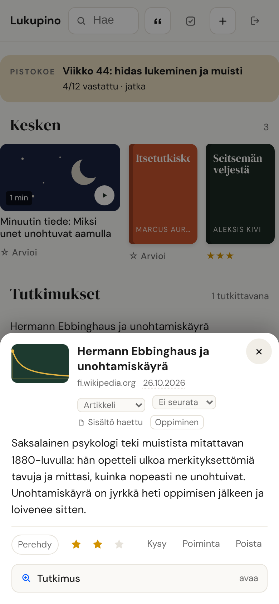
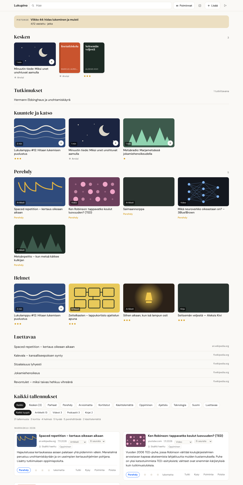
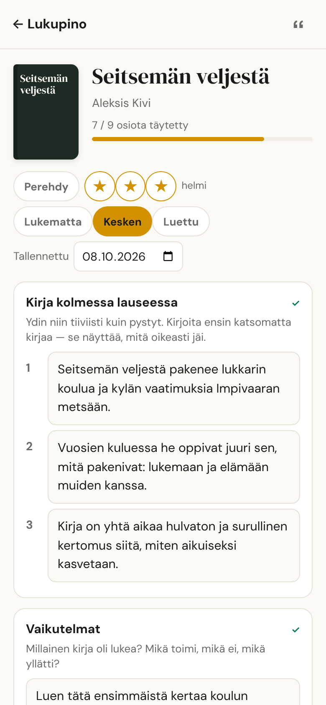
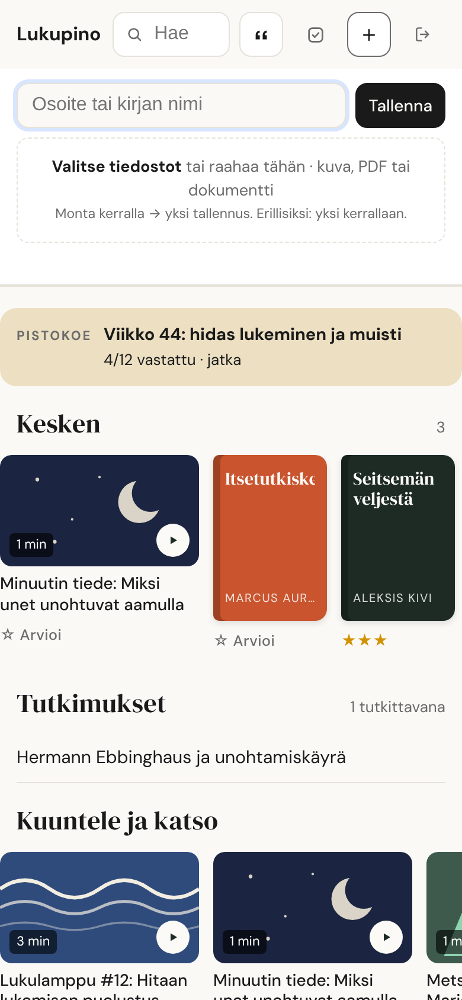
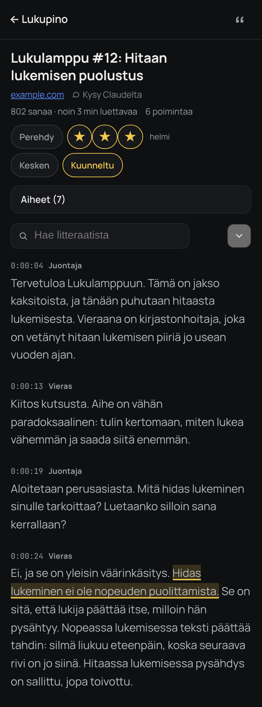
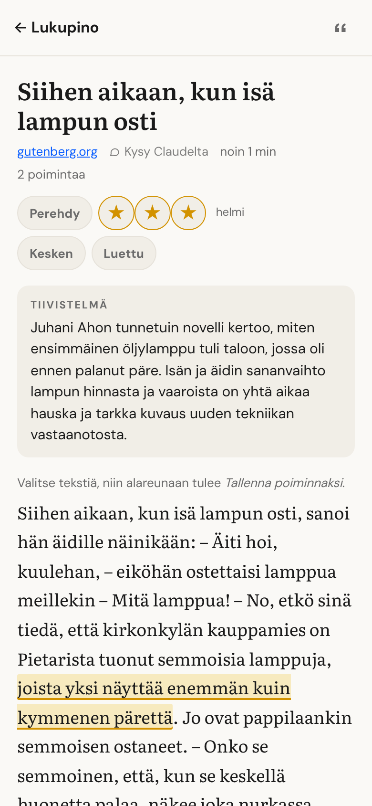
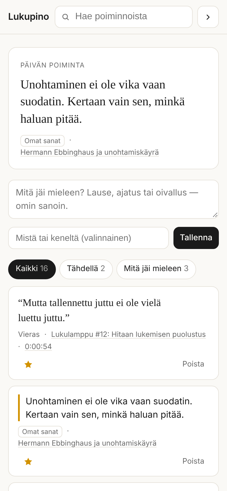
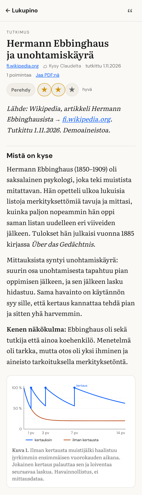
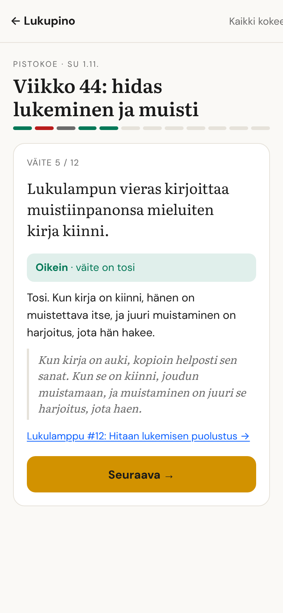
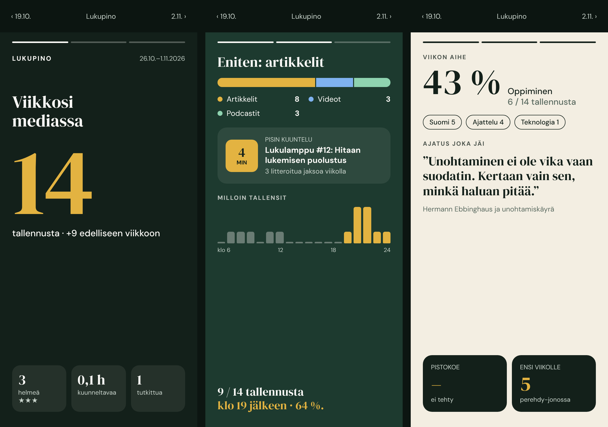

# Käyttöohje — kaikki ominaisuudet

Tämä on Lukupinon ominaisuuksien käsikirja: mitä kukin näkymä tekee, miten sitä
käytetään ja mihin päätteisiin se nojaa. Asennus on [INSTALL.md](../INSTALL.md):ssä,
iPhonen pikakomento [IPHONE.md](IPHONE.md):ssä ja rakenne
[ARCHITECTURE.md](ARCHITECTURE.md):ssä.

Esimerkkien `https://<osoitteesi>` on oman asennuksesi osoite, esim.
`https://lukupino.<tili>.workers.dev`. Sen näkee sivulta `/asennus`.

**Päivämäärät** kertovat, milloin ominaisuus tehtiin; muutokset löytyvät
[CHANGELOG.md](CHANGELOG.md):stä.

## Sisällys

- [Tallennus ja arviot](#tallennus-ja-arviot)
- [Etusivu: Hylly](#etusivu-hylly-17102026)
- [Mediatyyppi ja lukutila](#mediatyyppi-ja-lukutila)
- [Tiedostot](#tiedostot)
- [Koko litteraatti — lue ja korosta](#koko-litteraatti--lue-ja-korosta)
- [Jutun lähdeteksti — lue ja korosta](#jutun-lähdeteksti--lue-ja-korosta-17102026)
- [Poiminnat](#poiminnat--lainauskokoelma-ja-mitä-jäi-mieleen)
- [Omin sanoin ja kirjamuistio](#omin-sanoin--oppimiskerros)
- [Tutkimus](#tutkimus--jaa-numerolla-4-20102026)
- [Pistokoe](#pistokoe-20102026)
- [Viikko mediassa](#viikko-mediassa-22102026)
- [Kysy Claudelta](#kysy-claudelta-27102026)
- [Claude: liitin, Claude Code ja MCP-työkalut](#claude-liitin-claude-code-ja-mcp-työkalut)
- [YouTube- ja Spotify-kuvaukset](#youtube--ja-spotify-kuvaukset-valinnainen)
- [Siirto Karakeepistä](#siirto-karakeepistä)
- [Logo](#logo)
- [Suunnitteilla: podcast-merkki](#suunnitteilla-podcast-merkki-pienellä-eleellä-6112026)

## Tallennus ja arviot

<p align="center"></p>

Tallennat jakamalla: iPhonen jakovalikossa on pikakomento *Lukupino*, joka
kysyy arvion ja lähettää linkin, kuvan tai PDF:n. Työkoneella sama onnistuu
selaus-UI:n **Lisää**-kentästä tai raahaamalla tiedoston. Rakennusohje:
[IPHONE.md](IPHONE.md).

| Arvio | Nimi | Merkitys |
|---|---|---|
| `3` | ★★★ Helmi | Erinomainen; kortit ja tiivistelmät tehdään näistä ensin |
| `2` | ★★ Hyvä | Keskimääräistä parempi |
| `1` | ★ Kelpaa | Talteen |
| `0` | Perehdy | Lukematta, mutta haluat palata ja perehtyä. Ei huonompi kuin ykkönen, vaan eri asia: kun olet lukenut, vaihda se laatuarvioon 1–3 |
| `4` | Tutki tämä | Ei arvio vaan toimeksianto: aamurutiini kirjoittaa tallennuksesta tutkimuksen (ks. [Tutkimus](#tutkimus--jaa-numerolla-4-20102026)) |
| tyhjä | Ei arviota | Arvioit myöhemmin |

Saman linkin voi jakaa uudelleen eri numerolla: **arvio päivittyy** eikä
synny kaksoiskappaletta. Selaus-UI:ssa sama on tähtien vasemmalla puolella
oleva **Perehdy**-nappi ja ylärivin **Perehdy**-suodatin; haussa `rating:0`.

Worker hakee tallennettaessa vain otsikon, kuvauksen ja kansikuvan (10 ms
CPU-raja). Syvempi sisältö tulee aamurutiinilta (`skills/lukupino-rikasta`).
X, Reddit, Instagram, Facebook ja LinkedIn merkitään heti
`ei-noudettavissa`-tilaan; rutiini yrittää niitä julkisilla reiteillä
([LAHTEET.md](../skills/lukupino-rikasta/LAHTEET.md)).

## Etusivu: Hylly (17.10.2026)

<p align="center"></p>

Etusivun yläosassa on **Hylly**, rivit omistajan valitsemasta
suunnasta (viidestä luonnoksesta *Hylly*):

- **Kesken** — `progress:kesken`; kirjat kirjanselkinä, muut tiiliinä
- **Kuuntele ja katso** — litteroidut (`has:transcript`), tiili avaa soittimen
- **Tutkimukset** — kolme uusinta yhden rivin otsikkoina, loput *Näytä kaikki* -napin takana (20.10.2026)
- **Perehdy** (`rating:0`), **Helmet** (`rating:3`)
- **Luettavaa** — uusimmat artikkelit tiivistelmineen; rivi avaa kortin alapaneeliin (arvio, tila, tutkimus, poiminta, Lue ja korosta), josta pääsee takaisin hyllylle sulkemalla — ei rullaamista listaan eikä suoraan lähteeseen (21.10.2026)

Haun tai suodattimen aikana Hylly piiloutuu. Sen alla on *Kaikki
tallennukset* eli entinen lista suodattimineen ja kortteineen
ennallaan. Puhelimessa rivit pyyhkäistään, työkoneella ne rivittyvät.

**Työpöytä (22.10.2026):** vähintään 1 000 px leveässä ikkunassa sivu on
1 180 px eikä 820 px, kuvarivit ovat ruudukko 16:9-kuvin, kaikki
tallennukset kahdessa sarakkeessa ja korttipaneeli avautuu keskelle
ikkunaksi. Puhelimen näkymä on ennallaan.

Jokaisen tiilen ja kirjanselän alla on arvio (*☆ Arvioi*, *Perehdy* tai
tähdet). Napautus avaa alapaneelin: Perehdy ja 1–3 tähteä, kirjoille myös
lukutila. Sama valinta uudelleen poistaa arvion. Hyllyt eivät lataudu
heti uudelleen, ettei rivi hyppää kesken selaamisen.

## Mediatyyppi ja lukutila

Jokaisella tallennuksella on **mediatyyppi**: artikkeli, video, podcast,
kirja, some, dokumentti tai kuva. Se päätellään osoitteesta (`db.ts`
`mediaFor`, migraatiot 0010–0011), ja kortin pienestä valikosta sen voi
vaihtaa. Selaus-UI:n toinen suodatinrivi rajaa tyypin mukaan, ja se
yhdistyy ylärivin suodattimeen (esim. *Parhaat* + *Podcastit*).

**Jokaisella tallennuksella on tila** (21.10.2026 alkaen kaikilla medioilla,
ennen vain kirjoilla): lukematta, kesken tai luettu — videolla katsomatta /
katsottu, podcastilla kuuntelematta / kuunneltu. Sen voi asettaa kortin
valikosta, Hyllyn arviopaneelista sekä soittimen ja lukunäkymän otsikon alta
(*Kesken* ja *Katsottu / Kuunneltu / Luettu*).
**Kesken olevat näkyvät aina etusivun yläosassa** otsikolla *Kesken nyt*,
ja ylärivillä on *Kesken*-suodatin. Kirjan voi lisätä pelkällä nimellä
*Lisää*-kentästä: teksti, jossa on välilyönti tai jossa ei ole pistettä,
tulkitaan kirjan nimeksi, ja osoitteeksi tulee Google-kirjahaku.

**Tallennuspäivän voi korjata** (17.10.2026): kortin päivämäärä on
napautettava ja avaa päivävalitsimen. Tämä on tarkoitettu esimerkiksi
keväällä luetuille kirjoille, jotka on lisätty vasta nyt. Muutos siirtää
tallennuksen oikeaan kuukauteen seuraavalla latauksella. Päivä tallentuu
keskipäivään UTC-aikaa, joten se pysyy samana Suomen ajassa.
Tulevaisuuden päivä hylätään. Reitti on `POST /ui/bookmark/:id/date`, ja
MCP:ssä se on `update-bookmark savedAt: VVVV-KK-PP`.

<p align="center"></p>

**Kirjamuistio** (`/kirja/<id>`, 17.10.2026): kirja vaatii enemmän työtä ja
antaa enemmän, joten kirjoilla on oma sivu kortin *Omin sanoin* -kentän
sijaan. Kortissa on linkki *Kirjamuistio* (aloita/jatka), ja Hyllyn
kirjanselkä avaa sen. Sivun osiot noudattavat Ali Abdaalin
kirjamuistiinpanoja, ja kaksi osiota on lisätty:

- kirja kolmessa lauseessa
- vaikutelmat
- miten löysin kirjan
- kenelle suosittelen
- miten kirja muutti minua
- **mitä teen toisin**
- **luku luvulta** (+ Lisää luku)
- parhaat lainaukset
- vapaat muistiinpanot

Jokaisessa osiossa on ohjaava kysymys, ja täyttöaste näkyy otsikon alla.
Arvio, lukutila ja luettu-päivä ovat samalla sivulla. Muistio tallentuu
itsestään. Lainaukset tallentuvat Poimintoihin sivunumeron kanssa
(`at: "s. 42"`), ja Poiminnat-sivulla niissä on linkki *kirjamuistio*.

Tallennusmuoto: muistio on yksi teksti `recall`-kentässä otsikoittain
(`KIRJA_OSIOT`, `db.ts`). Ensimmäisen osion lauseet on numeroitu 1.–3.,
ja luvut alkavat `## `. Sivu jäsentää tekstin osioiksi. Tuntematon teksti
säilyy vapaissa muistiinpanoissa. `recall`-kentän yläraja on nyt
100 000 merkkiä (`MAX_RECALL`), jotta luvuittaiset muistiinpanot
mahtuvat. MCP:n `recall`-kuvaus kertoo saman rakenteen.

Haku ja MCP: `media:kirja`, `media:podcast,video`, `progress:kesken`,
`progress:any`. MCP:ssä `add-book` ja `update-bookmark` (`media`,
`progress`). `/api/update` hyväksyy samat kentät.

## Tiedostot

<p align="center"></p>

Selaus-UI:n **Lisää**-paneelissa on osoitekentän alla pudotusalue: valitse
tiedostot, raahaa ne siihen, tai **liitä leikepöydältä** (näyttökuva menee
talteen ilman välitallennusta).

**Monta tiedostoa kerralla → yksi tallennus.** Kuusi näyttökuvaa samasta
asiasta on yksi nosto, ei kuutta kirjanmerkkiä: otsikoksi tulee *"6 kuvaa"*,
ensimmäisestä kansikuva, ja kortille pikkukuvarivi josta jokaisen saa auki.
Erillisiksi ne saa antamalla yhden kerrallaan. Poisto vie kaikki tiedostot
mukanaan.

Tavut ovat **R2:ssa**, jos se on kytketty (ämpäri `lukupino-files`, 10 Gt
ilmaiseksi), muuten KV:ssä (binding `FILES`, 1 Gt). Raja on **20 Mt/tiedosto**.
Kirjanmerkkiin jää `file_key`, `file_type` ja `file_size`. Osoite on
`<osoitteesi>/file/<avain>` ja avautuu selaimessa kirjautuneena: kuvat ja
PDF:t näytetään, muut latautuvat. Kun R2 otetaan käyttöön myöhemmin,
`POST /api/files/migrate` siirtää KV:n tiedostot sinne. `GET /api/files/backend`
ja sivu `/asennus` kertovat, kumpi on käytössä.

Kuva saa itsensä kansikuvaksi. PDF ja dokumentti jäävät `inbox`-tilaan ja
`/lukupino-rikasta` lukee niistä tekstin — Workerissa se ei onnistu, koska
ilmaistason CPU-raja on 10 ms.

## Koko litteraatti — lue ja korosta

<p align="center"></p>

Litteroidulla videolla tai jaksolla on kortissa linkki **Koko litteraatti**
(`/litteraatti/<id>`). Näkymä on 17.10.2026 alkaen **Soitin**: YouTube- tai
Spotify-soitin on upotettu yläosaan (YouTube IFrame API, Spotify Embed
iFrame API), ja

- **teksti seuraa toistoa** — kappale korostuu ja vieritys pysyy kohdassa
  myös pitkän puheenvuoron sisällä; käsin vierittäminen keskeyttää
  seuraamisen (*Seuraa toistoa* palauttaa)
- **aikaleima siirtää soittimen** kohtaan sivulta poistumatta
- *−15 s*, nopeus (YouTube) ja **Poimi kappale** (soiva kappale poimintoihin);
  kun tekstiä on valittuna, nappi on *Tallenna valinta*
- **arvio** otsikon alla: Perehdy tai 1–3 tähteä
- jos upotus ei lataudu 12 sekunnissa, soitin piiloutuu ja aikaleimat avaavat
  lähteen kuten ennen. Spotify-jakson aikaleimat ovat RSS:n MP3:sta; jos
  Spotify lisää eri mainokset, kohta voi heittää muutaman sekunnin.

Lisäksi:

- teksti kappaleittain, aikaleima ja puhuja jokaisen alussa
- **aikaleima avaa lähteen siitä kohdasta** (YouTube `&t=`, Spotify `?t=`)
- **Aiheet** hyppylinkkeinä (kortin litteraatin AIHEET-osiosta)
- haku, osumat korostettuina, nuolesta seuraavaan
- **korosta tekstiä → alareunaan tulee *Tallenna poiminnaksi*.** Poiminta
  tallentuu puhujan ja aikaleiman kanssa tyypillä `korostus`, jota noten
  uudelleenkirjoitus ei poista. Tallennetut näkyvät litteraatissa
  sinisellä alleviivauksella, ja Poiminnat-sivulla niiden aikaleima on
  linkki takaisin litteraatin kohtaan (`#t=<sekunnit>`).

Litteraatti on omassa taulussaan (`transcripts`, migraatio 0009), koska
2 h jakso on ~140 000 merkkiä. Kirjanmerkillä on vain `transcript_words`.
Tekijä on `skills/litteroi/koko.py`.

## Jutun lähdeteksti — lue ja korosta (17.10.2026)

<p align="center"></p>

Jutulla, jolla on lähdeteksti (`excerpt`, vähintään 200 merkkiä), on
kortissa linkki **Lue ja korosta** (`/lue/<id>`). Se korvasi kortin
avattavan *Lähdeteksti*-laatikon. Näkymässä ovat otsikko, arvio,
tiivistelmä ja teksti kappaleittain. **Valitse tekstiä → alareunaan tulee
*Tallenna poiminnaksi*.** Poiminta tallentuu tyypillä `korostus`, näkyy
tekstissä korostettuna, ja Poiminnat-sivulla siinä on linkki *jutussa*
takaisin tänne. Hyllyn *Luettavaa*-rivit ja lähdetekstilliset tiilet
avautuvat tähän näkymään. Video ja podcast ilman litteraattia avaavat
lähteen kuten ennen.

Lähdeteksti on enintään 3 000 merkkiä (`MAX_EXCERPT`), joten pitkästä
jutusta näkyy alku. Loppuun tulee silloin maininta ja linkki
alkuperäiseen.

| Pääte | Mitä |
|---|---|
| `POST /api/transcript` `{id, text, source?}` | tallenna tai korvaa; `text: ""` poistaa (bearer) |
| `POST /api/transcript` `{id, unavailable: "<syy>"}` | ei saatavilla, `transcript_words: 0` (bearer) |
| `GET /api/transcript/:id` | litteraatti takaisin (bearer) |
| `GET /ui/transcript/:id` | lukunäkymän data ja kirjanmerkin poiminnat (istunto) |

## Poiminnat — lainauskokoelma ja "mitä jäi mieleen"

<p align="center"></p>

Selaus-UI:n yläpalkissa on **Poiminnat** (`/poiminnat`). Sinne kertyy kaksi
asiaa:

- **Lähteiden lainaukset itsestään.** Kun litteraatti kirjoitetaan
  `note`-kenttään `/api/update`:lla, Worker poimii sen POIMINNAT-osion
  rivit (`h:mm:ss – "lainaus"`, valinnaisesti `– Puhuja: "lainaus"`)
  tauluun `quotes`. Mitään ei tarvitse tehdä erikseen: rutiinin jono B
  täyttää kokoelmaa joka yö. Käyttöönotossa 4.10.2026 takautuvasti 279
  lainausta 66 lähteestä.
- **Omat sanat.** Poiminnat-sivun kentästä ("Mitä jäi mieleen?") tai
  kortin **Poiminta**-napista, jolloin poiminta liittyy siihen lähteeseen.
  *Mitä jäi mieleen* -välilehdellä näkyvät myös korttien Omin sanoin
  -tekstit.

Sivun yläosassa on **päivän poiminta** — sama koko päivän, tähdellä
merkityistä jos niitä on. Tähti nostaa poiminnan listan kärkeen ja suojaa
sen: kun litteraatti kirjoitetaan uudelleen, lähteen poiminnat luodaan
uusiksi, mutta tähdelliset ja omat säilyvät. Kun kirjanmerkki poistetaan,
sen lähdepoiminnat lähtevät mukana; omat sanat jäävät ilman lähdettä.

| Pääte | Mitä |
|---|---|
| `GET /ui/quotes?filter=kaikki\|tahti\|omat&q=` | listaus (istunto) |
| `POST /ui/quotes` `{text, bookmarkId?, who?, at?, kind?}` | oma poiminta tai litteraatin korostus (`kind: korostus`) (istunto) |
| `POST /ui/quotes/:id/star` · `/delete` | tähti, poisto (istunto) |
| `POST /api/quotes` `{quotes:[…]}` | lisäys suoraan (bearer) |
| `POST /api/quotes/sync` `{ids:[…]}` | poimi uudelleen noteista, ≤ 50 (bearer) |
| `GET /api/export` | sisältää nyt myös `quotes` |

## Omin sanoin — oppimiskerros

**21.10.2026 alkaen kenttä ei näy korteissa** — omistaja käyttää sen sijaan
poimintoja (kortin *Poiminta*-nappi, korostukset ja Poiminnat-sivun *oma*-tyyppi).
Kenttä `recall` on yhä kannassa: kirjoilla se on Kirjamuistion sisältö, ja
aiemmin kirjoitetut tekstit näkyvät Poiminnat-sivun *Omat*-välilehdellä.

Alkuperäinen ajatus: kenttä **Omin sanoin** täytettiin **lähteeseen katsomatta**: mitä jäi mieleen. Tämä on Farnam Streetin
*Blank Sheet* — se osa lukemisesta joka jää päähän, ja ainoa osa jota kone ei
voi tehdä puolestasi.

Kone ei koskaan kirjoita eikä ylikirjoita tätä kenttää. Kenttä on MCP:ssä
`recall` ja REST-päivityksessä `recall`.

## Tutkimus — jaa numerolla 4 (20.10.2026)

<p align="center"></p>

**4 ei ole arvosana vaan toimeksianto:** *tee tästä tutkimus*. Arvio (0–3)
ei muutu, joten helmenkin voi pyytää tutkittavaksi. Pyynnön voi tehdä

- jakaessa numerolla **4** (`/api/add?rating=4`, myös `/api/upload`:n
  `rating`-kenttä) — ilmoitukseen tulee *"· tutkitaan"*
- kortin **Tutki**-napista tai Hyllyn arviopaneelista (*Tutki tämä*)
- Claudelta: `request-research` tai *"tee tutkimukset"*

**Käynnistä nyt (22.10.2026).** Kun tutkimuksia on jonossa, Hyllyn
*Tutkimukset*-otsikon vieressä on *Käynnistä nyt*. Se ajaa päivittäisen
rikastusrutiinin heti eikä vasta aamulla: `POST /ui/purku` → rutiinin
API-laukaisin (`/v1/claude_code/routines/<PURKU_ROUTINE>/fire`). Napin
tilalle tulee *käynnissä hh.mm*, joka on linkki session lokiin. Toista
laukaisua ei tehdä 15 minuuttiin (KV `purku:viimeisin`, säilyy tunnin), ja
Anthropicin raja on 30 käsin tehtyä laukaisua tunnissa rutiinia kohden.
Nappi näkyy vain, kun `PURKU_TOKEN` on asetettu. Asetukset: [routines/README.md](../routines/README.md), kohta *Käynnistä nyt*.

Aamurutiini (jono E, enintään kaksi per ajo) kirjoittaa tutkimuksen
sapluunalla [`skills/lukupino-tutki/SKILL.md`](../skills/lukupino-tutki/SKILL.md):
mistä on kyse, keskeiset käsitteet räjäytettynä, suhde teoriaan, mitä tämä
muistuttaa (myös *Lukupinossasi jo*), oppimispolku kolmella tasolla ja
harjoitus, avoimet kysymykset ja tarkistetut lähteet. Sapluuna hyväksyttiin
ensimmäisellä tutkimuksella.

Valmis tutkimus näkyy kortissa linkkinä **Tutkimus**, Hyllyn rivillä
*Tutkimukset* ja sivulla `/tutkimus/<id>`: palvelin muuntaa markdownin
HTML:ksi (`renderMarkdown`, `research.ts`; kaikki teksti escapetaan, linkeistä
vain http(s)), ja tekstiä voi korostaa poiminnoiksi kuten litteraatissa.

**Kuvat** (1.11.2026): tutkimuksessa voi olla 1–5 kuvaa aidattuina
lohkoina ```` ```svg Kuvateksti ```` ja ```` ```mermaid Kuvateksti ````.
SVG siivotaan palvelimella (`sanitizeSvg`: ei skriptejä, `style`-, `image`-,
`use`- eikä `foreignObject`-elementtejä, ei `on*`-attribuutteja eikä ulkoisia
linkkejä, enintään 80 000 merkkiä) ja piirretään sellaisenaan; värit tulevat
`--k-*`-muuttujista, joten sama kuva toimii vaaleassa, tummassa ja PDF:ssä.
Yli 600 leveä SVG vierii puhelimessa sivuttain. Mermaid 10.9.1 ladataan
jsDelivristä vain sivuille, joilla on kaavio (`securityLevel: strict`), ja
sen värit luetaan samoista muuttujista. Ohjeet kirjoittajalle:
`skills/lukupino-tutki/SKILL.md`, vaihe 3b.

Tila on kirjanmerkillä (`research_status`: `pyydetty` → `valmis` tai
`ei-onnistu` syineen) ja teksti taulussa `research` (migraatio 0012).
Uudelleenjako numerolla 4 ei tyhjennä valmista tutkimusta; uusiminen on
`force`.

**Jaettava versio ja PDF** (20.10.2026): tutkimussivun linkki *Jaa PDF:nä*
avaa `/tutkimus/<id>/jaa`-sivun. Siinä on kansi (logo, otsikko, *Mikä tämä
on?* ja menetelmä viisivaiheisena kaaviona), tutkimus omalta sivultaan ja
alatunniste. **Omistajan omat yhteydet jätetään pois:** listakohdat, jotka
alkavat `**Lukupinossasi jo:**` tai `**Omassa työssäsi:**` (`stripPersonal`).
*Tallenna PDF:ksi* avaa selaimen tulostuksen (A4, `@page`-asetukset); iPhonessa
Safarin Jaa → Tulosta → nipistä → Jaa PDF:nä. Sivu vaatii kirjautumisen, joten
jaetaan PDF eikä linkkiä.

| Pääte | Mitä |
|---|---|
| `POST /api/research` `{id, text}` | tallenna markdown, tila valmis (bearer) |
| `POST /api/research` `{id, failed: "<syy>"}` | ei onnistunut (bearer) |
| `POST /api/research` `{id, request: true\|false, force?}` | pyydä tai peru (bearer) |
| `GET /api/research/:id` | teksti takaisin (bearer) |
| `GET /ui/research/:id` · `POST /ui/bookmark/:id/research` | lukunäkymä ja Tutki-nappi (istunto) |

**Oppimispolku pinoon** (20.10.2026): tutkimussivulla jokaisen
*Oppimispolku*-osion linkin perässä on nappi **+ pinoon**. Se tallentaa
linkin (`POST /ui/add`) arviolla Perehdy, joten suositus odottaa
Perehdy-hyllyssä. Jos linkki on jo pinossa, nappi sanoo sen.

## Pistokoe (20.10.2026)

<p align="center"></p>

Omistajan idea: oikein/väärin-väitteitä siitä, mitä viikon aikana luki,
katsoi ja kuunteli, jotta näkee mitä jäi mieleen, mitä ei ja mihin
kannattaa syventyä. Muistista palauttaminen kiinnittää luetun paremmin kuin
uudelleenlukeminen, joten koe on oppimisen väline eikä arvosana.

1. **Sunnuntaisin klo 17.58** ajastettu rutiini ajaa skillin
   [`skills/lukupino-pistokoe`](../skills/lukupino-pistokoe/SKILL.md):
   12 väitettä viikon kulutetuista tallennuksista (arvio 1–3, lukutila,
   Omin sanoin tai oma poiminta; Perehdy ei ole kulutettu), vain lukupinon
   sisällöstä, enintään kolme per lähde. Mukana enintään kolme kertausta
   aiemmista kokeista. Ilmoitus tulee puhelimeen linkin kanssa.
2. Omistaja vastaa sivulla `/pistokoe/<id>`: **Tosi**, **Epätosi** tai
   **En muista**, ja tosi/epätosi-vastaukseen lisäksi **Varma** tai
   **Arvaan**. Oikea vastaus, perustelu, katkelma lähteestä ja linkki
   lähteeseen (litteraatti, lukunäkymä, kirjamuistio tai tutkimus) näkyvät
   heti. Ensimmäinen vastaus jää voimaan.
3. Lopuksi tulos: oikein n/12, varmoista oikein, *varma mutta väärin*,
   arvauksista oikein ja ei muistissa, sekä lähteittäin heikoin ensin.
4. **Seuraava aamurutiini** (jono F) kirjoittaa palautteen: mikä jäi
   mieleen, mikä ei, varmuus, mihin syventyä ja mitä kerrataan.
5. Väärin menneet, *en muista* ja arvaukset palaavat kertaukseen aikaisintaan
   10 päivän päästä (`repeat_of`).

**Lähtötasotesti** (21.10.2026) aloittaa fokusoidun oppimispolun:
16 väitettä aiheen kahdeksalta osa-alueelta (perus ja edistynyt),
tarkistettuna ensisijaisesta lähteestä kuten virallisesta dokumentaatiosta.
Väitteellä on `area`, `level`, `src_url` ja `src_title` (migraatio 0014);
sivu näyttää osa-alueen jo kysyttäessä ja tuloksen osa-alueittain heikoin
ensin. Tuloksesta tehdään oppimispolku. Ensimmäinen: *Lähtötasotesti:
Claude Code*.

Etusivulla on banneri uusimmasta kokeesta, kunnes siihen on vastattu ja
palaute on ollut esillä kolme päivää; yläpalkin ruutukuvake avaa listan
`/pistokoe`. Worker ei kutsu kielimallia: väitteet ja palaute tekee rutiini.
Taulut `quizzes` ja `quiz_items` (migraatio 0013).

| Pääte | Mitä |
|---|---|
| `POST /api/quiz` `{title, scope?, items:[{statement, correct, explanation, bookmark_id?, anchor?, kind?, view?, repeat_of?, area?, level?, src_url?, src_title?}]}` | luo koe, 3–20 väitettä (bearer) |
| `GET /api/quiz` · `GET /api/quiz/:id` | lista · väitteet vastauksineen (bearer) |
| `GET /api/quiz/kertaus?days=10&limit=6` | kerrattavat väitteet (bearer) |
| `POST /api/quiz/:id/feedback` `{text}` | palaute markdownina (bearer) |
| `GET /ui/quiz` · `GET /ui/quiz/:id` · `POST /ui/quiz/:id/answer` | sivu ja vastaukset (istunto); vastaamattomasta näytetään vain väite |

## Viikko mediassa (22.10.2026)

<p align="center"></p>

`/viikko` on Spotify Wrappedin tapainen kolmen ruudun tarina yhdestä
viikosta (ma–su, Helsingin aikaa). Puhelimessa ruutua vaihdetaan
pyyhkäisemällä tai napauttamalla reunaa, ja työpöydällä ruudut ovat
rinnakkain. `/viikko/<pvm>` näyttää sen päivän viikon, ja nuolilla pääsee
edelliseen ja seuraavaan viikkoon kuluvaan viikkoon asti.

1. **Kansi:** tallennusten määrä ja muutos edelliseen viikkoon, helmet,
   kuunneltavaa (litteraattien sanat ÷ 212 sanaa/min) ja viikolla
   valmistuneet tutkimukset.
2. **Mitä kulutit:** mediajakauma, pisin litteroitu kuuntelu ja
   tallennusajat tunneittain (klo 19 jälkeen korostettuna).
3. **Ajatus joka jäi:** viikon aihe listoista (*Luettavaa* ja *Sisältö
   puuttuu* eivät ole aiheita), viikon oma tai tähditetty poiminta,
   viikon pistokoe ja Perehdy-jonon pituus.

Oletus on viimeisin päättynyt viikko, sunnuntaina klo 17 jälkeen kuluva
viikko. Etusivulla on banneri sunnuntai-illasta keskiviikkoon. Luvut
lasketaan kannasta pyynnön aikana (`src/viikko.ts`), eikä mallia kutsuta.
**Luvut kertovat mitä tallensit, eivät mitä luit:** lukutilaa merkitään
liian harvoin, jotta siitä voisi laskea kulutusta.

## Kysy Claudelta (27.10.2026)

Kortin alarivillä on *Kysy*, ja litteraatin, lukunäkymän ja tutkimuksen
otsikkorivillä on *Kysy Claudelta*. Nappi avaa uuden claude.ai-keskustelun
(`claude.ai/new?q=…`), johon on valmiina kirjoitettu otsikko, osoite,
lukupinon id, tiivistelmä ja ohje hakea koko sisältö lukupinon
MCP-työkaluilla (`get-bookmark-content`, `get-transcript`, `get-research`).
Keskustelu toimii täysin vain, jos claude.ai:ssa on Lukupino-liitin.
Kehote kopioidaan myös leikepöydälle, koska `?q=`-parametri ei ole
virallisesti dokumentoitu: jos esitäyttö ei toimi, kehotteen voi liittää.
Koodi on `src/kysy.ts`.

## Claude: liitin, Claude Code ja MCP-työkalut

Vaatimukset, kaikki asiakkaat ja vianetsintä: **[MCP.md](MCP.md)**. Lyhyesti:

**claude.ai ja Claude-sovellus:** Asetukset → Liittimet → Lisää mukautettu
liitin → URL `https://<osoitteesi>/mcp` → kirjaudu GitHubilla. Liitin on
tilikohtainen, joten se näkyy myös puhelimen Claude-sovelluksessa. Ilmaisella
Claude-tilillä voi olla yksi mukautettu liitin.

**Claude Code:** `.mcp.json` projektin juuressa (valmis rivi on sivulla
`/asennus`):

```json
{ "mcpServers": { "lukupino": { "type": "http", "url": "https://<osoitteesi>/mcp",
  "headers": { "Authorization": "Bearer ${LUKUPINO_MCP_TOKEN}" } } } }
```

`LUKUPINO_MCP_TOKEN` on Workerin `MCP_TOKEN`, ympäristömuuttujana koneella,
jolla Claude Code ajaa.

### MCP-työkalut

`search-bookmarks` (kvalifioijat `after: before: list: status: rating: has:note has:excerpt has:transcript is:inlist url:`,
sivutus `nextCursor`) · `get-bookmark` · `get-bookmark-content` · `create-bookmark` ·
`update-bookmark` (summary/note/status) · `delete-bookmark` · `get-lists` ·
`get-list-bookmarks` · `add-bookmark-to-list` · `remove-bookmark-from-list` · `get-stats`.
Nimet ovat Karakeepin MCP:n nimiä, jotta sille tehdyt skillit toimivat sellaisinaan.

Lisätty 17.10.2026 (omia, ei Karakeepissa):

- `get-transcript` — koko litteraatti. `query` palauttaa vain osuvat kappaleet
  aikaleimoineen; ilman sitä palat ajasta `fromSeconds` alkaen (`maxChars`
  1 000–60 000), ja vastaus kertoo seuraavan `fromSeconds`-arvon.
- `search-quotes` — poiminnat: lähteiden lainaukset (`lahde`), omistajan
  korostukset litteraateista (`korostus`) ja omat sanat (`oma`); suodattimet
  `query`, `kind`, `starredOnly`, `bookmarkId`.
- `add-note` — muistiinpano kirjanmerkille: lisätään päivättynä rivinä noten
  loppuun osioon `## Muistiinpanot`, olemassa olevaa ei koskaan korvata
  (note sisältää litteraatin aiheet ja poiminnat). Lisätty samana päivänä.
- `add-quote` — poimintakokoelmaan: `oma` (omat sanat, oletus) tai
  `korostus` (lähteen kohta sanatarkasti), valinnaisesti `bookmarkId`, `who`,
  `at` (aikaleima tai sivu).

- `get-research` · `request-research` · `save-research` (20.10.2026) —
  tutkimus: lue valmis, pyydä tai peru (`force` uusii valmiin), tallenna
  markdown tai `failedReason`. Haussa `research:pyydetty|valmis|any`.

- `list-quizzes` · `get-quiz` · `create-quiz` · `save-quiz-feedback`
  (21.10.2026) — pistokoe ja lähtötasotesti: listaa tuloksineen, lue koe
  vastauksineen ja perusteluineen, tee uusi koe suoraan keskustelusta
  (`skills/lukupino-pistokoe`-säännöillä) tai kirjoita palaute.

- `attach-file` — tekstimuotoinen tiedosto (`.html .md .txt .csv .json .svg`,
  enintään 2 M merkkiä) lukupinoon: `bookmarkId`:n kanssa liitteeksi
  tallennukseen (näkyy kortissa, päivätty rivi muistiinpanoihin), ilman sitä
  omaksi tallennuksekseen (HTML:stä teksti otteeksi, rutiini tiivistää).
  Tyypillisesti claude.ai:ssa tehty artefakti, esim. yhteenveto kirjasta.

**HTML ja SVG eristetään.** Ne tarjoillaan lukupinon omasta osoitteesta,
joten `/file`-vastauksessa on `Content-Security-Policy: sandbox …` ilman
`allow-same-origin` ja katselusivun iframe on `sandbox`-määreellä.
Artefaktin skriptit toimivat, mutta eivät pääse evästeeseen eivätkä
`/ui/*`-reitteihin kirjautuneena — todennettu 17.10.2026 testitiedostolla,
joka yritti molempia (SecurityError, TypeError). Markdown, teksti, CSV ja
JSON näytetään katselusivulla tekstinä.

`update-bookmark` vie nyt noten POIMINNAT-osion kokoelmaan kuten
`/api/update` — ennen 17.10.2026 MCP:llä kirjoitettu note ei päivittänyt
poimintoja.

**claude.ai:hin** lukupino kytketään mukautettuna liittimenä: URL
`https://<osoitteesi>/mcp`, kirjautuminen GitHubilla
(OAuth, vain `ALLOWED_GITHUB_LOGIN`). Claude Code käyttää samaa päätettä
staattisella `MCP_TOKEN`illa.

**Testaus:** `wrangler dev` ei rekisteröi MCP-työkaluja paikallisesti
(Durable Object ei saa `props`ia, joten sallitun käyttäjän tarkistus
palauttaa tyhjän palvelimen). MCP testataan tuotannossa bearerilla.

## YouTube- ja Spotify-kuvaukset (valinnainen)

Ilman avaimia lukupino saa YouTubelta ja Spotifylta **otsikon, tekijän ja
kansikuvan** avaimettomasta oEmbed-päätteestä. Kuvausta se ei anna, ja
status jää siksi `ei-noudettavissa`.

Kaksi ilmaista avainta korjaa sen. **Koodi on jo valmiina** — se tunnistaa
avaimen olemassaolon ja alkaa hakea kuvauksia heti kun salaisuus on
asetettu. Ilman avainta mikään ei rikkoudu.

Salaisuudet asetetaan **Cloudflaren hallintapaneelissa**, ei repoon eikä
chattiin: Workers & Pages → `lukupino` → Settings → Variables and Secrets →
Add → tyypiksi **Secret**.

### YouTube Data API v3 → `YOUTUBE_API_KEY`

1. <https://console.cloud.google.com> → luo projekti (tai valitse olemassa oleva)
2. APIs & Services → **Library** → hae `YouTube Data API v3` → **Enable**
3. APIs & Services → **Credentials** → Create credentials → **API key**
4. Rajaa avain: Edit → API restrictions → **Restrict key** → YouTube Data API v3
5. Kopioi avain Cloudflaren salaisuudeksi nimellä `YOUTUBE_API_KEY`

Kiintiö on 10 000 yksikköä vuorokaudessa ja yksi videohaku maksaa 1
yksikön, joten raja ei tule vastaan. Google vaatii projektille laskutustilin
vain osalle rajapinnoistaan — YouTube Data API kuuluu ilmaisiin.

### Spotify: kuvaus tulee ilman avainta

13.9.2026 alkaen Worker hakee jakson kuvauksen, keston ja MP3-osoitteen
**ohjelman RSS-syötteestä** — Spotify on vain jakelukanava. Mitattu 6/7
jaksoa. Avainta ei tarvita. Jos jakso jää silti ilman kuvausta,
`fetchNote` kertoo miksi (`rss: …`), ja päivittäinen rutiini osaa hakea
syötteen omasta osoitteestaan.

Alla oleva Spotify Web API -reitti on koodissa **varalla**, jos RSS-reitti
ei jotain ohjelmaa löydä. Käytännössä sitä ei tarvitse tehdä.

### Spotify Web API → `SPOTIFY_CLIENT_ID` + `SPOTIFY_CLIENT_SECRET` *(varareitti)*

1. <https://developer.spotify.com/dashboard> → kirjaudu Spotify-tilillä
2. **Create app**
   - Nimi ja kuvaus: vapaat, esim. `lukupino`
   - **Redirect URI**: pakollinen kenttä, mutta tätä ei käytetä.
     Anna `https://<osoitteesi>/callback`
   - Rastita käyttöön **Web API**
3. Avaa sovellus → **Settings** → sieltä löytyvät **Client ID** ja
   **View client secret**
4. Vie molemmat Cloudflaren salaisuuksiksi nimillä `SPOTIFY_CLIENT_ID` ja
   `SPOTIFY_CLIENT_SECRET`

Lukupino käyttää **client credentials** -kulkua: se hakee tunnuksen omaan
lukuunsa eikä koskaan sinun tilisi puolesta, joten soittolistoihin tai
kuunteluhistoriaan se ei pääse. Tunnus elää tunnin ja välimuistitetaan
KV:hen, joten tallennus tekee normaalisti yhden kutsun eikä kahta.

### Kun avaimet ovat paikallaan

Uudet tallennukset saavat kuvauksen heti. Vanhat täydentyvät seuraavassa
aamurutiinissa (`POST /api/enrich` ajaa noudon heti).

## Siirto Karakeepistä

Jos tulet Karakeepistä, `migrate-from-karakeep.py` siirtää kirjanmerkit,
korttien muistiinpanot ja listat. Ajo on idempotentti, joten sen voi toistaa.

```bash
KARAKEEP_URL=https://<karakeep-palvelimesi> KARAKEEP_API_KEY=… \
  python3 migrate-from-karakeep.py https://<osoitteesi> "$LUKUPINO_CAPTURE_TOKEN"
```

URL-ittomat liitetiedostot (`type: asset`) jäävät pois. **Cloudflare torjuu
Pythonin oletus-user-agentin** virheellä 1010; skripti asettaa oman
`User-Agent`-otsikon. Vertaa määriä Karakeepiin ennen kuin puret sen.

## Logo

"Pino, tumma" (valittu 10.10.2026), lähteet `assets/lukupino-logo.svg` ja
`assets/lukupino-logo-1024.png`. Worker tarjoaa sen julkisesti osoitteissa
`/apple-touch-icon.png` (180 px), `/favicon.svg` ja `/favicon.ico`, ja
jokaisen sivun `<head>` viittaa niihin (`src/icon.ts`). Jo kotivalikkoon
lisätty lukupino pitää vanhan kuvakkeen, kunnes se lisätään uudelleen.

## Suunnitteilla: podcast-merkki pienellä eleellä (6.11.2026)

**Tila: suunnitelma, ei koodia.** Omistajan idea: kuunnellessa pieni ele
tallentaa Spotifyssa soivan jakson kohdan, josta lainaus otetaan myöhemmin
litteraatista. Rakentaminen odottaa omistajan kahta asiaa (alla).

**Kulku**

1. **Ele → iOS-pikakomento.** Vaihtoehdot: AirPods + *"Hei Siri, merkkaa"*
   (kädet vapaina, omistajalle suositeltu), takanapautus (Asetukset →
   Käyttöapu → Kosketus → Takanapautus, näyttö päällä) tai toimintopainike
   / lukitusnäytön ohjain. Pikakomento kutsuu bearer-tokenilla uutta reittiä,
   esim. `POST /api/merkki`, ja näyttää palvelimen `message`-kentän
   ilmoituksena (*"Merkitty: Joe Hudson, 0:42:15"*), kuten `/api/add`.
2. **Worker kysyy Spotifylta mitä soi:**
   `GET https://api.spotify.com/v1/me/player/currently-playing?additional_types=episode`
   palauttaa jakson (`item`, `currently_playing_type: episode`) ja kohdan
   (`progress_ms`). Vaatii käyttäjän valtuutuksen (authorization code,
   scope `user-read-currently-playing`). Refresh token KV:hen; kerran tehtävä
   yhdistäminen istuntoportin takana: `/spotify/login` → `/spotify/callback`.
   Nykyinen `spotifyToken` (client credentials, `src/fetchmeta.ts`) ei riitä
   tähän.
3. **Tallennus:** jakson kirjanmerkki haetaan URL:lla
   `https://open.spotify.com/episode/<id>` tai luodaan, ja merkki
   tallennetaan aikaleimoineen (esim. `quotes`-tauluun omalla `kind`-arvolla
   tai omaan tauluunsa; päätetään rakentaessa).
4. **Merkistä lainaus:** litteraattinäkymässä (`/litteraatti/<id>`) merkki
   näkyy hyppylinkkinä, joka näyttää tekstin noin ±90 s merkin ympäriltä;
   lauseen napautus tekee poiminnan (`kind: korostus`) kuten nyt. Jos
   jaksoa ei ole litteroitu, se nousee litterointijonoon.

**Rajoitteet**

- **Aikaleima voi heittää.** Litteraatti tehdään RSS:n MP3:sta, ja
  dynaamisesti lisätyt mainokset voivat siirtää Spotifyn kohtaa kymmeniä
  sekunteja. Siksi näytetään ikkuna, ei yhtä lausetta.
- **Spotifyn kehittäjätila 2/2026:** sovelluksen omistajalla pitää olla
  Premium, muuten sovellus lakkaa toimimaan; enintään 5 käyttäjää per
  sovellus. `currently-playing`, `GET /episodes/{id}` ja `GET /shows/{id}`
  ovat yhä käytössä; erämuotoiset `GET /episodes` ja `GET /shows`
  poistettiin. Lähteet: [migraatio-opas](https://developer.spotify.com/documentation/web-api/tutorials/february-2026-migration-guide),
  [muutosluettelo](https://developer.spotify.com/documentation/web-api/references/changes/february-2026),
  [Get Currently Playing Track](https://developer.spotify.com/documentation/web-api/reference/get-the-users-currently-playing-track).

Rakentaminen vaatii Spotify-kehittäjäsovelluksen, jonka omistajalla on Premium, ja sen Redirect URI:ksi `https://<osoitteesi>/spotify/callback`.
