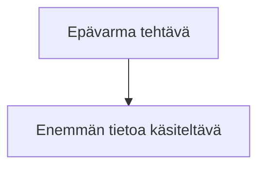

# Lukupinon tutkimus

Omistaja jakaa linkin numerolla **4** tai painaa kortin **Tutki**-nappia,
kun haluaa ymmärtää aiheen syvemmin kuin tallennus kertoo: *"do a research
for me"*. Tutkimus on toimeksianto, ei arvosana: arvio (0–3) pysyy ennallaan.

Sapluuna hyväksyttiin 20.10.2026 ensimmäisellä tutkimuksella
(REA: Reverse Engineer Anything) sanoin *"Tämä on
täydellinen"*. Älä muuta rakennetta kysymättä — se on omistajan.

## Jono

- MCP: `search-bookmarks research:pyydetty` (vanhin ensin, `sortOrder: asc`).
- Rutiini ilman MCP:tä: `/api/export` → `research_status == "pyydetty"`.

Enintään **2 per ajo** rutiinissa; käsin pyydettäessä kaikki. Tutkimus vie
noin 10–20 hakua, joten jono ei saa syödä rikastuksen aikaa.

## Vaihe 1 — Lue lähde ensin

Tutkimus alkaa siitä mitä tallennus oikeasti sanoo, ei otsikosta.

1. `get-bookmark` (summary, excerpt, note). Jos sisältöä ei ole, hae se:
   tavallinen sivu WebFetchillä, X/Reddit/Substack
   [`LAHTEET.md`](../lukupino-rikasta/LAHTEET.md):n pelastusreiteillä. X:ssä sisältö on usein
   kuvassa: **lataa ja katso kuva** (20.10.2026 REA:n nimi oli vain kuvassa).
2. Jos tallennus viittaa johonkin (repo, paperi, kirja), lue se alkuperäinen
   — REA:ssa README ja npm-paketti, ei vain twiittiä.
3. Jos sisältöä ei saada mitenkään: `save-research failedReason: <syy>`
   (REST: `{id, failed}`). **Älä kirjoita tutkimusta otsikosta.**

## Vaihe 2 — Tutki

- Hae verkosta aiheen keskeiset käsitteet, alan klassikkolähteet, kilpailevat
  tai edeltävät ratkaisut ja kriittiset näkökulmat.
- Hae omasta lukupinosta yhteyksiä: `search-bookmarks` aiheen sanoilla ja
  lähikäsitteillä (useampi haku, `next_cursor` loppuun). Ne ovat osion
  *Lukupinossasi jo* raaka-aine.
- **Jokainen linkki on haettu tai löytynyt hausta.** Kirjat ja paperit
  nimetään tekijän ja vuoden kanssa; jos et löytänyt niistä varmistusta,
  jätä ne pois. Keksitty lähde on pahempi kuin puuttuva.
- Erota myyjän, vaikuttajan tai projektin omat väitteet riippumattomista
  (REA:ssa tähtimäärät 115 000–335 000 vaihtelivat lähteittäin).
- Jos et saanut jotain varmistettua (esim. lain nykyistä sanamuotoa), sano se
  lopun *Varaus*-rivillä.

## Vaihe 3 — Kirjoita sapluunalla

Suomeksi, markdownina. Pituus noin 1 200–1 800 sanaa (≈10 min luettavaa).
Otsikot tasan nämä, tässä järjestyksessä:

```markdown
*Lähde: <kuka>, <missä> <pvm> → [<kohde>](<osoite>). Tutkittu <pvm>.*

## Mistä on kyse
<Muutama kappale: mikä tämä on ja mitä se lupaa. Lopuksi **Kenen näkökulma:**
kenen intressi tai kehys tässä on.>

## Keskeiset käsitteet
- **<Käsite>.** <Selitys ja konteksti: mitä tarkoittaa, mistä tulee, miten
  liittyy juuri tähän tallennukseen.>
<5–8 käsitettä. Tämä on "konseptin räjäytys": omistajan sääntö on, että
listamaisessa lähteessä jokainen kohta selitetään ja sille annetaan konteksti.>

## Suhde teoriaan — mitä uutta tämä tuo
- **<Väite>.** <Mihin teoriaan tai keskusteluun liittyy, mitä tutkimus sanoo,
  mikä on oikeasti uutta ja mikä vanhaa uudessa paketissa. Myös kriittinen
  näkökulma ja riskit.>

## Mitä tämä muistuttaa
- **Edeltäjät / vaihtoehdot:** …
- **Lukupinossasi jo:** <omistajan omat tallennukset arvioineen ja päivineen,
  ja mikä niitä yhdistää>
- **Historiasta:** …

## Oppimispolku
**Taso 1 — <perusteet> (<aika-arvio>)**
- [<lähde>](<osoite>) — <miksi tämä, ilmainen?>
**Taso 2 — <työkalut / syvemmälle>**
**Taso 3 — alkuperäislähteet**
**Harjoitus tekemällä:** <yksi konkreettinen, turvallinen ja laillinen
harjoitus omalla koneella tai omassa arjessa>

## Avoimet kysymykset
- <2–4 kysymystä, joihin aihe jättää vastaamatta>

## Lähteet
- <kaikki käytetyt linkit>

*Varaus: <mitä ei saatu varmistettua>.*
```

**Omat yhteydet vain merkittyihin kohtiin.** Tutkimuksesta tehdään jaettava
versio (`/tutkimus/<id>/jaa`, PDF), josta omistajan henkilökohtaiset
viittaukset jätetään pois automaattisesti (`stripPersonal`, `research.ts`).
Pois jäävät vain listakohdat, jotka alkavat lihavoidulla
**`Lukupinossasi jo:`** tai **`Omassa työssäsi:`**. Kirjoita siis kaikki
omistajan tallennuksiin, omaan työhön tai repoon viittaava vain niihin —
ei muihin kappaleisiin ("elokuussa tallentamasi…" muualla vuotaa jaettavaan).

Vain jos aihe ei sovi johonkin osioon (esim. ei historiaa), jätä alakohta
pois — älä täytä tyhjää.

## Vaihe 3b — Kuvat (1–5)

Jokaiseen tutkimukseen 1–5 kuvaa, jotka näyttävät jotain mitä teksti ei
näytä yhtä nopeasti: mekanismi (silmukka, prosessi), vertailu (luvut
rinnakkain), aikajana tai käsitteiden suhteet. Ei koristekuvia: jos kuva vain
toistaa kappaleen, jätä pois. Yksi hyvä kuva on parempi kuin viisi.

Kuva on markdownissa aidattu lohko, ja aidan perään kirjoitetaan kuvateksti:

````markdown


```svg **Kuva 1.** Kuvateksti.
<svg viewBox="0 0 480 210" role="img" aria-label="Mitä kuvassa näkyy, lauseena." xmlns="http://www.w3.org/2000/svg">…</svg>
```
````

- **Mermaid** sopii vuokaavioihin (`flowchart TD`, pystysuunta toimii
  puhelimessa), aikajanoihin (`timeline`) ja sekvensseihin. Värejä ei
  määritellä: sivu antaa teeman. Pidä solmujen tekstit lyhyinä (≤ 40 merkkiä).
- **SVG** sopii pylväs- ja viivakaavioihin ja omiin piirroksiin. Värit vain
  muuttujina `style`-attribuutissa: `var(--k-fg)` teksti, `var(--k-mut)`
  toissijainen teksti ja viivat, `var(--k-line)` reunat ja ruudukko,
  `var(--k-bg)` laatikon tausta, `var(--k-soft)` pehmeä täyttö, `var(--k-acc)`
  korostus ja `var(--k-r)` vastakohta tai varoitus. Näin sama kuva toimii
  vaaleassa, tummassa ja PDF:ssä: sivu näyttää SVG:n kuvana ja korvaa
  muuttujat paletin väreillä (vaalea ja tumma versio). Fontit:
  `'DM Sans',sans-serif` ja `ui-monospace,Menlo,monospace`; kuvana näytetyssä
  SVG:ssä sivun verkkofontit eivät ole käytössä, joten loppuun aina yleinen
  perhe (`sans-serif`, `monospace`). Leveys (viewBox) mieluiten ≤ 600, sillä
  leveämpi vierii puhelimessa sivuttain. Enintään 80 000 merkkiä.
- Palvelin siivoaa SVG:stä skriptit, `style`-, `image`-, `use`- ja
  `foreignObject`-elementit, `on*`-attribuutit ja ulkoiset linkit, joten
  niitä ei kannata käyttää. Sisäiset `url(#id)`-viittaukset (nuolenpäät)
  toimivat.
- **Luvut vain varmistetuista lähteistä,** samat kuin tekstissä. Jos luku on
  havainnollistus (esim. kirjoittajan oma esimerkki), sano se kuvatekstissä.
  Älä keksi jakaumia tai trendejä kaavion täytteeksi.
- **Kuvateksti alkaa `**Kuva n.**`** ja kertoo väitteen ("hierarkiat
  litistyivät, mutta päätösvalta keskittyi ylös"), ei pelkkää aihetta.
- **`aria-label`** SVG:hen yhdellä lauseella, joka kertoo kuvan sisällön
  myös ilman kuvaa.
- Omat yhteydet eivät kuulu kuviin, koska ne näkyvät myös jaettavassa
  versiossa.
- Sijoita kuva sen osion alkuun tai loppuun, jota se havainnollistaa, ei
  kesken listan.

## Vaihe 4 — Tallenna

- MCP: `save-research bookmarkId text`.
- REST (rutiini):

  ```bash
  python3 -c "import json;print(json.dumps({'id':'<id>','text':open('/tmp/t.md').read()}))" > /tmp/t.json
  curl -sS -X POST -H "$H" -H "$A" -H "Content-Type: application/json" \
    --data-binary @/tmp/t.json "$B/api/research"
  ```

  (`$H`, `$A`, `$B` kuten `skills/lukupino-rikasta/SKILL.md`:ssä.) Vastaus
  `{"research_status":"valmis","chars":n}`. Tarkista `GET /api/research/<id>`.

- Jos tallennukselta puuttui otsikko tai tiivistelmä ja luit sisällön, korjaa
  ne samalla (`update-bookmark` / `/api/update`) — muuten kortti näyttää
  pelkän osoitteen.

Valmis tutkimus näkyy kortissa linkkinä **Tutkimus**, Hyllyn rivillä
*Tutkimukset* ja sivulla `/tutkimus/<id>`, josta omistaja korostaa poimintoja.

## Vastaus

Yksi rivi per tutkimus: `🔬 <otsikko> → valmis (n sanaa, m lähdettä)` tai
`– <otsikko> → ei onnistunut: <syy>`. Lopuksi jonon koko ennen ja jälkeen.
